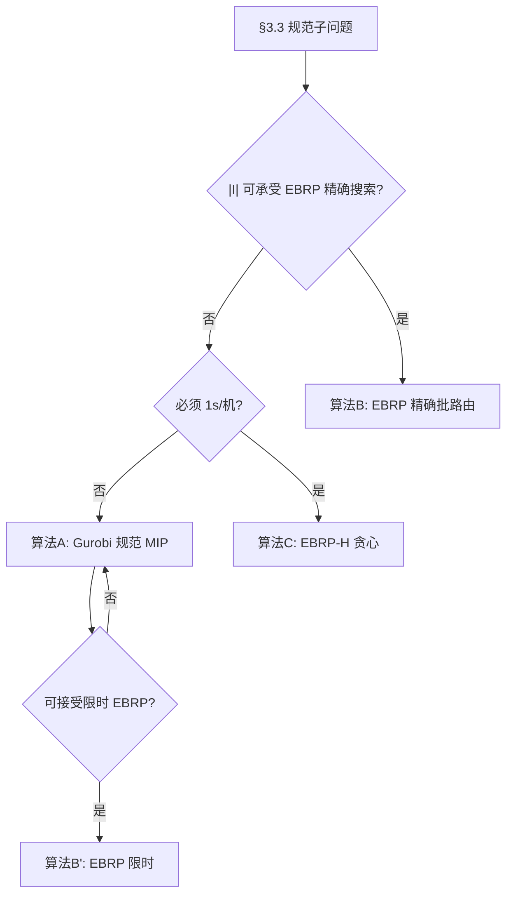

# 考虑时效限制的配置依赖的装箱-批量规模问题  

## 1. 问题背景

### 1.1 工业场景

某制造企业需要将多种 **WIP（待固化物料）** 放入工业 **热压罐（autoclave）** 完成固化。每种物料：

- 具有一定的**工装长度**属性，若干物料在工装上，装入同一热压罐时总长度不能超过罐体容量；
- 必须在特定 **固化配置（config）** 下加工，同一罐内同一时刻只能运行一种配置；
- 确定固化配置后，须连续运行该配置若干时段（配置相关加工时间）。

固化完成后，物料**直接作为最终产品**满足外部需求（本项目**已去除**原论文中的装配工序，不考虑 BOM）。

### 1.2 相对 EJOR 的两类更改/扩展

**（A）单件物料 + 加工时间窗 + 报废**

- $i\in I$ 为**单件物料编码**（如 MR001），每件恰 1 单位 WIP；
- $X_{imt}\in\{0,1\}$：物料 $i$ 是否在热压罐 $m$ 的第 $t$ 期开始进罐；
- 物料 $i$ 须在 $rel_i \le t \le end_i$ 内开始进罐，否则报废：$\sum_{m\in M}\sum_{t:\,rel_i\le t\le end_i} X_{imt} + R_i = 1$。

**（B）物料—配置 + 合批 + 阶跃加工时长**

- 每件 $i$ **直接**对应固化配置 $u(i)\in U$（`item_config`，与 EJOR 一致）；
- 参数 $lt_{it}$ 表示：若物料 $i$ 在 $t$ 期开工，占罐（生产提前期）为 $lt_{it}$ 个时段；由**数据预处理**给定，在 $rel_i \le t \le end_i$ 内随 $t$ **分段阶跃、单调不减**——距 $rel_i$ 越远（等待越久），$lt_{it}$ 越大。

预处理示意（配置 $u=u(i)$ 的等待阶梯 $\mathcal{S}_u$、基准占罐 $l_u$、时段长 $h$）：

$$
\omega_{it}=(t-rel_i)\cdot h,\qquad
lt_{it}=l_{u(i)}+\left\lceil \Delta_{u(i)}(\omega_{it})/h\right\rceil,\quad rel_i\le t\le end_i.
$$

其中 $\Delta_{u(i)}(\omega)$ 由 $\mathcal{S}_{u(i)}$ 按等待小时**取档、不累加**。同配置不同物料因 $rel_i$ 不同，在同一 $t$ 开工时 $lt_{it}$ 可不同。

**合批**：同 $(m,t)$、同配置 $u$ 的多件 $i\in I_u$ 可合批；该次 setup 的实际跨期数 $L_{u,m,t}=\max\{lt_{it}: i\in I_u,\,X_{imt}=1\}$。批内物料**同进同出**，于 $t+L_{u,m,t}-1$ 一并完工。

---

## 2. 集成模型（IM）建模

### 2.1 集合与索引（集合大写，输入参数小写）

| 符号 | 含义 |
|------|------|
| $T$ | 离散计划时段集合，$|T|$ 为计划期长度 |
| $I$ | **物料编码集合**（如 MR001），每件 1 单位 WIP |
| $U$ | 固化配置集合 |
| $u(i)\in U$ | 物料 $i$ 的固化配置 |
| $I_u=\{i\in I: u(i)=u\}$ | 配置 $u$ 可加工的单件集合 |
| $M$ | 热压罐集合 |
| $rel_i,\,end_i$ | 物料 $i$ 最早 / 最晚开始进罐时段 |
| $d_{it}$ | 需求（0/1） |
| $lt_{it}$ | 物料 $i$ 在 $t$ 期开工时的占罐时段数（预处理给定，阶跃式增长） |
| $v_i$ | 工装长度 |
| $hc_i,\,bc_i,\,pc_{mu},\,rc_i$ | 持货、缺货、生产（setup）、报废成本 |
| $q_m$ | 热压罐 $m$ 容量 |

### 2.2 决策变量（大写）

| 符号 | 含义 | IM 类型 |
|------|------|---------|
| $X_{imt}$ | 物料 $i$ 是否在热压罐 $m$ 的第 $t$ 期开始进罐 | 0/1 |
| $R_i$ | 物料 $i$ 是否报废（与生产二选一） | 0/1 |
| $Y_{umt}$ | 热压罐 $m$ 在第 $t$ 期开始按配置 $u$ 生产 | 0/1 |
| $C_{i,m,t,t'}$ | 在 $(m,t)$ 开工的物料 $i$ 于 $t'$ 期生产完成 | 0/1 |
| $L_{u,m,t}$ | $(m,t)$ 上配置 $u$ 本次 setup 的实际跨期数 | $\mathbb{Z}_+$ |
| $S_{it}^+$ | 库存 | 0/1 |
| $S_{it}^-$ | 缺货 | 0/1 |

### 2.3 目标函数

$$
\min \underbrace{\sum_{i\in I}\sum_{t\in T} hc_{i} \cdot S_{it}^+}_{\text{持货}}
+ \underbrace{\sum_{i\in I}\sum_{t\in T} bc_i \cdot S_{it}^-}_{\text{缺货}}
+ \underbrace{\sum_{t\in T}\sum_{m\in M}\sum_{u\in U} pc_{mu} \cdot Y_{umt}}_{\text{生产（setup）}}
+ \underbrace{\sum_{i\in I} rc_{i} \cdot R_i}_{\text{报废}}
$$

### 2.4 约束体系

**成品流平衡**（完工量经 $C$ 进入库存；报废则不交付需求）：

$$
S_{i,t-1}^+ - S_{i,t-1}^- + \sum_{m\in M}\sum_{t'\in T}C_{i,m,t',t}
= d_{it}\cdot (1-R_{i}) + S_{it}^+ - S_{it}^-
\quad \forall i \in I,\; t \in T
$$

**每期至多一种新开配置**：

$$
\sum_{u \in U} Y_{umt} \leq 1
\quad \forall m \in M,\; t \in T
$$

**开始生产约束**（有生产必有 setup，有 setup 必有生产）：

$$
\sum_{i\in I_{u}}X_{imt}\le |I_{u}|\cdot Y_{umt},
\quad \forall t\in T,\; m\in M,\; u\in U
$$

$$
Y_{umt}\le \sum_{i\in I_u} X_{imt},
\quad \forall t\in T,\; m\in M,\; u\in U
$$

**跨期数下界**（合批取批内最大 $lt_{it}$；最优解中 $L_{u,m,t}=\max\{lt_{it}: i\in I_u,\,X_{imt}=1\}$）：

$$
L_{umt}\ge lt_{it} \cdot X_{imt},
\quad \forall u\in U,\; i\in I_{u},\; m\in M,\; t\in T
$$

$$
L_{umt}\le \bar M\cdot Y_{umt},
\quad \forall u\in U,\; m\in M,\; t\in T
$$

**完工时刻**（$C_{i,m,t,t'}=1$ 当且仅当在 $(m,t)$ 开工并于 $t'=t+L_{u(i),m,t}-1$ 完工）：

$$
t+L_{u(i),m,t}-1-t'\le BigM\cdot (1-C_{i,m,t,t'}),
\quad \forall i\in I,\; m\in M,\; t,t'\in T
$$

$$
t+L_{u(i),m,t}-1-t'\ge -BigM\cdot (1-C_{i,m,t,t'}),
\quad \forall i\in I,\; m\in M,\; t,t'\in T
$$

$$
\sum_{t'\in T}C_{i,m,t,t'}=X_{imt},
\quad \forall i\in I,\; m\in M,\; t\in T
$$

**机台不重叠**（若 $t'>t$ 且 $(m,t)$、$(m,t')$ 均有 setup，则前次占罐须在 $t'$ 前结束）：

$$
L_{umt}-BigM\cdot (2-Y_{umt}-Y_{u',m,t'})\le t'-t,
\quad \forall m\in M,\; u,u'\in U,\; t,t'\in T,\; t'> t
$$

**热压罐长度容量**（开工时刻装箱，EJOR 惯例）：

$$
\sum_{i \in I} v_i \cdot X_{imt} \leq q_m
\quad \forall m \in M,\; t\in T
$$

**单件去向**：

$$
\sum_{m\in M} \sum_{t:\,rel_i\le t\le end_i} X_{imt} + R_i = 1
\quad \forall i \in I
$$

**时间窗与计划期末可行**：

$$
X_{imt} = 0,
\quad \forall i\in I,\; m\in M,\;
t < rel_i \;\text{ 或 }\; t > end_i \;\text{ 或 }\; t+lt_{it}-1 > |T|
$$

---

## 3. Dantzig-Wolfe 分解

### 3.1 分解思路

将 IM 按**热压罐** $m\in M$ 做结构分解：每台罐在规划期内的可行生产计划（含 setup 序列、装箱、占罐跨期）构成一列（column / 计划模式）。跨罐耦合仅通过**物料去向**与**库存—缺货流平衡**体现，子问题在单机上保持 IM 的全部机台侧约束。

记 $\mathcal{K}_m$ 为罐 $m$ 的可行列集合。列 $k\in\mathcal{K}_m$ 用参数刻画（对给定 $m$ 为常数）：

| 参数 | 含义 |
|------|------|
| $x_{imt}^k\in\{0,1\}$ | 列 $k$ 是否在 $(m,t)$ 开工加工物料 $i$ |
| $y_{umt}^k\in\{0,1\}$ | 列 $k$ 是否在 $(m,t)$ 对配置 $u$ 开 setup |
| $L_{umt}^k\in\mathbb{Z}_+$ | 列 $k$ 在 $(m,t)$ 上配置 $u$ 的占罐跨期（合批取 $\max lt_{it}$） |
| $c_m^k$ | 列 $k$ 在罐 $m$ 上的 setup 成本 $\sum_{u,t} pc_{mu}\,y_{umt}^k$ |
| $a_{i,t'}^{k}$ | 列 $k$ 在时段 $t'$ 对物料 $i$ 的**完工入库量**（由 $C$ 语义导出；若在 $(m,t)$ 开工且 $t'=t+L_{u(i),m,t}^k-1$ 则 $a_{i,t'}^{k}=x_{imt}^k$） |
| $w_i^k$ | 列 $k$ 对物料 $i$ 的**窗内开工量** $\sum_{t:\,rel_i\le t\le end_i} x_{imt}^k$ |

列 $k$ 须满足 §3.3 所列单机约束（详见下文），且 $x_{imt}^k=0$ 当 $i$ 不在该列所选配置的批次中。

### 3.2 主问题（限制主问题 LRMP）

引入连续列权重 $\theta_{mk}\ge 0$（代码中记为 $Q_{mk}$），以及松弛的库存、缺货、报废变量：

$$
\min \ \sum_{i,t} hc_i S_{it}^+ + \sum_{i,t} bc_i S_{it}^- + \sum_{i} rc_i R_i
+ \sum_{m\in M}\sum_{k\in\mathcal{K}_m} c_m^k \,\theta_{mk}
$$

$$
\text{s.t.}\quad
\sum_{m\in M}\sum_{k\in\mathcal{K}_m} a_{i,t'}^{k}\,\theta_{mk}
+ S_{i,t'-1}^+ - S_{i,t'-1}^- - S_{i,t'}^+ + S_{i,t'}^- = d_{i,t'}
\quad \forall i\in I,\; t'\in T
\qquad\text{(流平衡，对偶 $\alpha_{i,t'}$)}
$$

$$
\sum_{m\in M}\sum_{k\in\mathcal{K}_m} w_i^k\,\theta_{mk} + R_i = 1
\quad \forall i\in I
\qquad\text{(单件去向，对偶 $\rho_i$)}
$$

$$
\sum_{k\in\mathcal{K}_m} \theta_{mk} \le 1
\quad \forall m\in M
\qquad\text{(每罐至多选一个计划模式，对偶 $\beta_m$)}
$$

$$
S_{it}^+, S_{it}^-, R_i \ge 0
$$

可选**有效不等式**（根节点加强，见 `lrmp_cuts.py`）：截止期覆盖、同期至多一 setup、WIP 加工下界、setup 对冲突对等。

**性质**：$\theta_{mk}$ 松弛为连续变量时，LRMP 目标值为 IM 的**下界**（在列集包含 IM 最优解所对应的单机计划时，下界随列生成单调改善）。

### 3.3 定价子问题（单机 $m$，完整约束）

固定一台热压罐 $m\in M$。列生成在可行列集合 $\mathcal{K}_m$ 上寻找**约化成本**最小的列 $k$；列由该机上的调度方案刻画，**不含**主问题中的 $S_{it}^\pm$、$R_i$（报废与库存—缺货由 LRMP 处理）。

#### 决策变量

| 符号 | 域 | 含义 |
|------|-----|------|
| $X_{imt}$ | $\{0,1\}$ | 物料 $i$ 是否在 $(m,t)$ 开工进罐 |
| $Y_{umt}$ | $\{0,1\}$ | $(m,t)$ 是否对配置 $u$ 新开 setup |
| $L_{umt}$ | $\mathbb{Z}_+$ | $(m,t)$ 上配置 $u$ 本次 setup 的占罐跨期（合批取 $\max_i lt_{it}$） |

规范列中每件物料在本机至多开工一次；多机分配由主问题凸组合 $\sum_m\theta_{mk}$ 实现。

#### 约化成本目标

给定 LRMP 对偶 $(\alpha_{it},\,\rho_i,\,\beta_m)$，定价子问题为：

$$
\min\ \underbrace{\sum_{u\in U}\sum_{t\in T} pc_{mu}\,Y_{umt}}_{c_m^k}
\ -\ \beta_m
\ -\ \sum_{i\in I}\rho_i \underbrace{\sum_{t:\,rel_i\le t\le end_i} X_{imt}}_{w_i^k}
\ -\ \sum_{i\in I}\sum_{t'\in T}\alpha_{i,t'}
\underbrace{\sum_{t\in T:\,t'+lt_{it}-1=t'} X_{imt}}_{a_{i,t'}^k}
$$

即寻找列 $k\in\mathcal{K}_m$ 使 $c_m^k - \beta_m - \sum_i\rho_i w_i^k - \sum_{i,t'}\alpha_{i,t'}a_{i,t'}^k$ 最小；若最小值 $<0$，将对应列加入 LRMP。

#### 约束（§2.4 在固定 $m$ 下的完整形式）

以下各式均对**给定** $m\in M$ 成立；$\bar M$ 为足够大的常数（与 IM 中 $BigM$ 同阶）。

**(1) 每期至多一种新开配置**

$$
\sum_{u\in U} Y_{umt} \le 1
\quad \forall t\in T
$$

**(2) 开始生产（$X$–$Y$ 双向绑定）**

$$
\sum_{i\in I_u} X_{imt} \le |I_u|\cdot Y_{umt},
\qquad
Y_{umt} \le \sum_{i\in I_u} X_{imt}
\quad \forall u\in U,\; t\in T
$$

**(3) 配置匹配**

$$
X_{imt} \le Y_{u(i),m,t}
\quad \forall i\in I,\; t\in T
$$

（等价地：$u\neq u(i)$ 时 $X_{imt}=0$。）

**(4) 跨期数下界与 setup 联动**（合批取批内最大占罐）

$$
L_{umt} \ge lt_{it}\,X_{imt}
\quad \forall u\in U,\; i\in I_u,\; t\in T
$$

$$
L_{umt} \le \bar M\cdot Y_{umt}
\quad \forall u\in U,\; t\in T
$$

最优列中 $L_{umt}^k=\max\{lt_{it}: i\in I_u,\,x_{imt}^k=1\}$。

**(5) 机台不重叠**（$t'>t$ 且两时刻均有 setup 时，前次占罐须在前者结束前完成）

$$
L_{umt} - \bar M\,(2 - Y_{umt} - Y_{u'mt'}) \le t' - t
\quad \forall u,u'\in U,\; t,t'\in T,\; t'>t
$$

**(6) 热压罐长度容量**（开工时刻装箱）

$$
\sum_{i\in I} v_i\,X_{imt} \le q_m
\quad \forall t\in T
$$

**(7) 时间窗与计划期末可行**

$$
X_{imt} = 0
\quad \text{若 } t<rel_i,\; t>end_i,\; \text{或 } t+lt_{it}-1>|T|
$$

**(8) 物料–热压罐可加工关系（dedicated eligibility）**

记 $M_i\subseteq M$ 为物料 $i$ **允许**加工的机台集合（算例字段 `item_machines`；$|M_i|$ 可为 $1,\ldots,|M|$；缺省为全体机台）。则

$$
X_{imt} = 0
\quad \forall i\in I,\; m\notin M_i,\; t\in T
$$

IM 中 fate 约束 $\sum_{m\in M_i}\sum_{t\in[E_i,D_i]} X_{imt}+R_i=1$ 亦仅在 $M_i$ 上求和。

---

#### 可加工关系下的子问题结构（重分析）

引入 (8) 后，对固定机台 $m$ 的有效物料集为

$$
I_m := \{\, i\in I : m\in M_i \,\},\qquad |I_m|=\sum_{i\in I} b_{im}
$$

**与一对一专属的区别**：$M_i$ 可为多台机，故同一物料可在列生成中由**不同机器的列**竞争承接；但单机定价子问题仍只含 $I_m$，规模取决于**并集覆盖**而非全局 $|I|$。

**并行精确定价墙钟**（$|M|$ 个 worker 各解一台）：

$$
T_{\text{pricing}}^{\parallel} = \max_{m\in M} T_m^{\text{EBRP}}(I_m,\alpha,\rho,\beta_m)
$$

要在 **1 秒内并行求完所有子问题且精确**，需 $\max_m T_m^{\text{EBRP}}\le 1\text{s}$。充分条件：

1. $\max_m |I_m| \lesssim 40$（EBRP 精确搜索经验阈值）；
2. 批目录规模 $\sum_{u,t}|{\cal B}_{umt}|$ 受 $|I_u\cap I_m|$ 与窗长约束——窄时间窗 + 小 $|M_i|$ 最有效；
3. 对偶幅度适中（CG 首轮 $\alpha,\rho$ 过大时路由节点仍可能爆炸，与 $|I_m|$ 无关）。

Set-C 生成默认 $|M_i|\in\{1,2\}$ 随机，故 $\mathbb{E}[|I_m|]\approx |M_i|_{\text{avg}}\cdot|I|/|M| \approx 1.5\times 223/5 \approx 67$；若需稳定 1s 并行精确，应控制 **$\max_m|I_m|$**（而非仅平均），例如生成后再平衡机台负载。

| 量 | 无 $M_i$ 限制 | 一般 $M_i\subseteq M$ |
|----|---------------|------------------------|
| 单机池规模 | $|I_u|\approx|I|/|U|$ | $|I_u\cap I_m|$，随 $|M_i|$ 减小 |
| 并行墙钟 | $\max_m T_m(|I|)$ | $\max_m T_m(|I_m|)$ |
| 精确算法 | EBRP per $m$ | 同左；$|M|$ 路 `ProcessPoolExecutor` |

**精确算法**：**EBRP**（§3.7）按 $b_{im}$ 过滤池；CG 用 `pricing_workers=0`（按机器数开进程池），一次 `map` 并行定价，墙钟 = 最慢单机。

**1 秒硬限时**：当 CG 早期迭代对偶过强、$\max_m T_m^{\text{EBRP}}\gg 1\text{s}$ 时，改用 **EBRP-H**（§3.4 算法 C）：复用同一批目录，以事件驱动贪心选最负 $\delta$ 批路由，保证每机墙钟 $\le 1\text{s}$，输出**可行列**（非精确最优约化成本）。Set-C 默认 `pricing_mode="ebrp_heuristic"`。

---

可行解 $(X,Y,L)$ 定义列 $k\in\mathcal{K}_m$：$x_{imt}^k=X_{imt}$，$y_{umt}^k=Y_{umt}$，$L_{umt}^k=L_{umt}$；$w_i^k$、$a_{i,t'}^k$、$c_m^k$ 由 §3.1 参数表从 $(X,Y,L)$ 导出。子问题即 $\mathcal{K}_m$ 上的上述 MIP。

### 3.4 子问题求解策略

§3.3 为**规范定价模型**（与 §2 IM 单机部分一致）。列生成按规模选用 **EBRP**（精确批路由搜索）、**EBRP-H**（1s 贪心启发）或 **Gurobi MIP**（`pricing_im_gurobi.py`）求解定价子问题。

#### 适用性判断

| 子问题特征 | 推荐算法 | 代码 |
|------------|----------|------|
| **§3.3 规范子问题**，$\|I\|\lesssim 40$，对偶温和 | **EBRP**（§3.7，批路由记忆化搜索，精确） | `pricing_ebrp.solve_subproblem_ebrp` |
| **§3.3 规范子问题**，$\|I_m\|\lesssim 80$ 但 CG 对偶强、需 **1s/机** | **EBRP-H**（§3.4 算法 C，贪心批路由，可行列） | `pricing_ebrp_heuristic.solve_subproblem_ebrp_heuristic` |
| **§3.3 规范子问题**，$\|I\|$ 较大且需精确最优 | **Gurobi MIP**（直接建模 §3.3） | `pricing_im_gurobi.solve_subproblem_im_gurobi` |
| 对照 / 限时精确 | **EBRP（限时）** + `ebrp_force` | 分支定价叶节点或对照实验 |
| 小算例对照验证 | EBRP 与 Gurobi §3.3 交叉检验 | `experiments/run_ebrp_validation.py` |

**默认策略**（`configuration.SET_C_CG`）：`pricing_mode="ebrp_heuristic"`，`ebrp_time_limit=1.0`。`ebrp_force` 强制精确 EBRP；当 $\max_m |I_m|>\texttt{EBRP\_EXACT\_MAX\_ITEMS}$（默认 40）且未指定启发式时回退 Gurobi。引入物料–机台专属后，应以 $|I_m|$ 而非全局 $|I|$ 判定。

#### 算法 A：Gurobi 精确 MIP（通用兜底）

**适用条件**：任意 §3.3 子问题；$|I|$、$|T|$ 较大，或作为正确性基准。

变量 $X_{imt},Y_{umt}\in\{0,1\}$，$L_{umt}\in\mathbb{Z}_+$；约束为 §3.3 全部七类；目标为 §3.3 约化成本。Set-C 规模下单机 MIP 可能较慢，适合大规模 CG 或算法验证。

小算例 CG 可在初始列阶段设 `use_gurobi_init=True`（仅首轮用 Gurobi）；`pricing_mode="im_gurobi"` 则全程 Gurobi。

#### 算法 B：EBRP — 规范 §3.3 精确定价（推荐）

当必须保持 $lt_{it}$ 阶跃、$X_{imt}\in\{0,1\}$ 与单件唯一性 $\sum_t X_{imt}\le 1$ 时，采用 **EBRP**（Exact Batch-Route Pricing）。完整规格见 **§3.7**。

要点：将子问题化为**有限批目录**上的**带资源（单件）约束的时序路由**；用记忆化深度优先搜索 + TD 路由下界剪枝，**搜索完成即精确最优**；与 Gurobi 规范 MIP 等价，但利用批结构与 $|\mathcal{L}_{ut}|$ 小等性质，小算例实践中常更快。

#### 算法 C：EBRP-H — 1 秒贪心批路由（Set-C 默认）

当精确 EBRP 无法在 1s 内完成（典型：CG 第 1–10 轮强对偶、路由节点 $>10^5$）时，采用 **EBRP-H**（`pricing_ebrp_heuristic.py`）：

1. **批目录**：与 §3.7.2 相同调用 `build_batch_catalog`（共享 `EBRPContext` 缓存），目录构建亦受 `deadline` 截断；
2. **贪心路由**：按事件时刻 $t=1,\ldots,T_{\max}$ 扫描；在 $\mathcal{B}_{\cdot t}$ 中选 $\delta$ 最小且与已加工物料不冲突的批并入解；推进 $t\leftarrow t+\text{span}$；
3. **可行性**：每批满足 §3.3 动态 $L$、不重叠与 $\sum_t X_{imt}\le 1$；`fixed_y=0` 的 $(u,\tau)$ 从目录剔除；
4. **性质**：输出列**可行**但 $\eta_m$ 一般 **$\ge \eta_m^*$**（弱对偶）；LRMP 下界仍有效，收敛速度取决于启发式列质量。

**压测**（`set_c_01_elig`，$|I_m|\in[55,79]$，5 机并行）：

| 场景 | $\max_m T_m$ | 说明 |
|------|--------------|------|
| EBRP 精确 + CG iter-1 对偶 | $>240\text{s}$（单机） | 不可用于 1s 目标 |
| EBRP-H + 同对偶 | **0.41s** | 强对偶仍 $<1\text{s}$ |
| EBRP-H 全程 CG | **0.45s/轮**，116 轮 / 84s 收敛 | `LRMP=155{,}303`，`min_RC>0` |



### 3.7 算法 B：EBRP 精确批路由定价（设计规格）

本节给出与 §3.3 **等价**的精确定价算法，供实现 `pricing_ebrp.py`。算法分两阶段：**批目录生成**（多项式伪多项式）+ **带单件约束的路由搜索**（最坏指数，可剪枝）。

#### 3.7.1 问题等价重构

固定热压罐 $m$。在可用物料集 $I$、时段 $T=\{1,\ldots,T_{\max}\}$ 上，一次 **setup 批** 由三元组 $b=(u,\tau,S)$ 刻画：

| 符号 | 含义 |
|------|------|
| $u\in U$ | 配置 |
| $\tau\in T$ | 开工时刻 |
| $S\subseteq I_u$ | 本批加工的单件集合（$\|S\|\ge 1$） |
| $L_b$ | 占罐跨期 $L_b=\max_{i\in S} lt_{i\tau}$ |
| $V_b$ | 对偶收益 $V_b=\sum_{i\in S}\bigl(\rho_i+\alpha_{i,\,\tau+L_b-1}\bigr)$ |
| $\delta_b$ | 批边际成本 $\delta_b=pc_{mu}-V_b$ |

**可行性**：$rel_i\le\tau\le end_i$、$\tau+L_b-1\le T_{\max}$（$\forall i\in S$），$\sum_{i\in S}v_i\le q_m$，且 $u=u(i)$。

**列（单机计划）** 为批序列 $\mathcal{B}=(b_1,\ldots,b_K)$，满足：

1. **不重叠**：若 $b_k=(u_k,\tau_k,S_k)$、$b_{k+1}=(u_{k+1},\tau_{k+1},S_{k+1})$，则 $\tau_{k+1}\ge\tau_k+L_{b_k}$；
2. **单件唯一**：$S_a\cap S_b=\varnothing$（$\forall a\neq b$）；
3. 未出现在任何 $S_k$ 中的物料在本机列中**不加工**（$w_i^k=0$，由主问题其他机台列覆盖）。

列的约化成本（与 §3.3 一致）：

$$
\mathrm{RC}(\mathcal{B})=\sum_{k=1}^{K}\delta_{b_k}-\beta_m.
$$

定价子问题等价于 $\min_{\mathcal{B}\ \text{可行}}\mathrm{RC}(\mathcal{B})$。若最优值 $<0$，将对应 $(X,Y,L)$ 转为列加入 LRMP。

#### 3.7.2 阶段一：批目录（Batch Catalog）

对每个 $(u,\tau)$，不枚举 $2^{|I_u|}$ 子集，而按占罐档位 $L\in\mathcal{L}_{u\tau}$ 分层生成**帕累托最优批**。

记 $I_{u\tau}(L)=\{i\in I_u:\ rel_i\le\tau\le end_i,\ lt_{i\tau}=L,\ \tau+L-1\le T_{\max}\}$，$I_{u\tau}^{<L}=\{i\in I_{u\tau}:\ lt_{i\tau}<L\}$。

对**锚点** $j\in I_{u\tau}(L)$，解 **0-1 背包**（强制 $x_j=1$）：

$$
\max\sum_{i\in I_{u\tau}^{<L}\cup\{j\}} \underbrace{(\rho_i+\alpha_{i,\tau+L-1})}_{\text{val}_i}\cdot x_i
\quad\text{s.t.}\quad \sum_i v_i x_i\le q_m,\ x_i\in\{0,1\}.
$$

用 DP 得到重量—价值**帕累托前沿** $\mathcal{F}_{u\tau L j}$（至多 $O(|I_{u\tau}|\cdot q_m^{\mathrm{sc}})$ 个点，$q_m^{\mathrm{sc}}$ 为容量缩放整数）。前沿上每点对应一批 $S$；合并所有锚点 $j$ 与档位 $L$ 后，对同一 $(u,\tau)$ 删去**批内支配**项：批 $S$ 被 $S'$ 支配若 $L_S=L_{S'}$、$V_S\le V_{S'}$、$\sum_{i\in S}v_i\ge\sum_{i\in S'}v_i$。

记最终目录 $\mathcal{C}=\mathcal{C}_{u\tau}$ 为从 $\tau$ 开工的全部非支配可行批；$|\mathcal{C}_{u\tau}|=O\bigl(|\mathcal{L}_{u\tau}|\cdot|I_{u\tau}|\cdot q_m^{\mathrm{sc}}\bigr)$。Set-C 上 $|\mathcal{L}_{u\tau}|\le 4$，单批 2–4 件，目录规模可控。

**与 TD 路由下界 的关系**：若去掉单件唯一、每 $(u,\tau)$ 只保留 $\delta$ 最小的批，阶段二退化为 §3.7.5 的 TD 路由下界（变长路由 DP），用作搜索**下界**。

#### 3.7.3 阶段二：记忆化批路由搜索（精确核心）

用可用物料位掩码 $\mathcal{A}\subseteq I$（实现用 `bitset`）与当前最早可开工时刻 $\tau$ 表示状态。

**值函数**（Bellman 形式）：

$$
F(\tau,\mathcal{A})=
\min\Biggl\{
\underbrace{F(\tau+1,\mathcal{A})}_{\text{时段 }\tau\text{ 空闲}},\ 
\min_{\substack{b=(u,\tau,S)\in\mathcal{C}_{u\tau}\\ S\subseteq\mathcal{A},\ \tau+L_b-1\le T_{\max}}}
\bigl[\delta_b+F(\tau+L_b,\mathcal{A}\setminus S)\bigr]
\Biggr\},
$$

边界 $F(T_{\max}+1,\mathcal{A})=0$。答案 $\eta_m^*=F(1,I)-\beta_m$。

**伪代码**（与 `SubproblemResult` 对齐）：

```
function solve_ebrp(m, α, ρ, β):
    lt_it ← preprocess
    C ← build_batch_catalog(m, α, ρ, lt_it)   // §3.7.2
    memo ← empty map
    best_plan ← null

    function F(τ, A):
        if τ > T_max: return 0
        if (τ, A) in memo: return memo[(τ, A)]

        ans ← F(τ+1, A)                                    // 空闲
        best_b ← null
        for each config u:
            for each batch b = (u, τ, S, L, δ) in C[u, τ]:
                if S ⊄ A: continue
                if τ + L - 1 > T_max: continue
                cand ← δ + F(τ + L, A \ S)
                if cand < ans:
                    ans ← cand; best_b ← b

        memo[(τ, A)] ← (ans, best_b)
        return ans

    rc ← F(1, I) - β
    plan ← backtrack(memo, 1, I)
    return to_SubproblemResult(plan, rc)
```

**回溯**：`memo` 存最优后继批 $b^\star$，从 $(1,I)$ 沿 $b^\star$ 走到 $\tau>T_{\max}$，构造 $Y_{u\tau}$、$X_{i\tau}$、$L_{u\tau}=\max_{i\in S}lt_{i\tau}$。

#### 3.7.4 剪枝与下界（保持精确性）

最坏状态数 $O(T_{\max}\cdot 2^{|I|})$，需剪枝但不损失最优性。

**剪枝 1 — TD 路由下界 乐观下界**（必安全）：

设 $\underline{F}(\tau,\mathcal{A})$ 为在物料集 $\mathcal{A}$、时段 $[\tau,T_{\max}]$ 上、**允许同件多批出现**的 TD 路由下界 最优值（§3.7.5）。则

$$
F(\tau,\mathcal{A})\ \ge\ \underline{F}(\tau,\mathcal{A}).
$$

若当前部分和 $\pi$ 满足 $\pi+\underline{F}(\tau,\mathcal{A})-\beta_m\ge 0$，则该分支**不可能**产生负约化成本列，可剪枝。若已求得 incumbent $\eta^{\mathrm{best}}$，当 $\pi+\underline{F}(\tau,\mathcal{A})-\beta_m\ge\eta^{\mathrm{best}}$ 时亦可剪枝。

**剪枝 2 — 批目录支配**：搜索中若两状态 $(\tau,\mathcal{A})$ 与 $(\tau,\mathcal{A}')$ 且 $\mathcal{A}\subseteq\mathcal{A}'$、$F(\tau,\mathcal{A})\le F(\tau,\mathcal{A}')$，则后者被支配；实现时对固定 $\tau$ 维护「已排物料超集 + 更优 $F$」的帕累托表（§3.7.6）。

**剪枝 3 — 分支定价固定**：`fixed_y[(u,τ)]=0` 时从 $\mathcal{C}_{u\tau}$ 删批；`=1` 时仅保留含该 $(u,\tau)$ 的批或强制该 setup。

**剪枝 4 — 时段聚合**（可选，不损最优）：仅当 $\mathcal{C}_{u\tau}\neq\varnothing$ 某 $u$ 时进入「开工」分支；空闲分支可跳至 $\min\{\tau':\mathcal{C}_{u\tau'}\neq\varnothing\}$。

#### 3.7.5 子程序：TD 路由下界（下界 / 松弛最优）

对给定 $(\tau,\mathcal{A})$，每批仍从 $\mathcal{C}_{u\tau}$ 取批，但**不删** $\mathcal{A}$ 中已用件（同件可重复计对偶）。值函数：

$$
\underline{F}(\tau,\mathcal{A})=
\min\Bigl\{
\underline{F}(\tau+1,\mathcal{A}),\ 
\min_{b=(u,\tau,S)\in\mathcal{C}_{u\tau}}
\bigl[\delta_b+\underline{F}(\tau+L_b,\mathcal{A})\bigr]
\Bigr\}.
$$

单阶段可预计算 $\eta_{u\tau}=\min_{b\in\mathcal{C}_{u\tau}}\delta_b$ 与 $L^\star_{u\tau}$，再用变长路由 DP：

$$
\phi(t)=\min\left\{\phi(t-1),\ \min_{u,\tau:\ \tau+L^\star_{u\tau}-1=t}\bigl[\phi(\tau-1)+\eta_{u\tau}\bigr]\right\},
$$

与算法 A 相同，仅 $\eta_{u\tau}$ 来自 §3.7.2 的规范批。复杂度 $O(|U|\cdot|T|^2\cdot|\mathcal{L}|)$，**每节点剪枝一次成本极低**。

#### 3.7.6 正确性

**命题 1（批表示完备性）**  
任意 §3.3 可行单机解，可唯一化为满足不重叠与单件唯一的批序列 $\mathcal{B}$，且 $\mathrm{RC}$ 与 §3.3 目标一致。

*证*：每个 $Y_{u\tau}=1$ 的 setup 对应一批 $S=\{i:X_{i\tau}=1\}$；约束 (2)(3)(6) 保证批可行；$L_{u\tau}=\max_{i\in S}lt_{i\tau}$ 与 (4)(5) 保证占罐与不重叠；单件唯一即 $\sum_\tau X_{i\tau}\le 1$ 等价于 $S_a\cap S_b=\varnothing$。□

**命题 2（$F(1,I)$ 最优性）**  
$F(\tau,\mathcal{A})$ 为满足「仅对 $\mathcal{A}$ 中物料、在 $[\tau,T_{\max}]$ 上排程」的最小批成本之和；故 $F(1,I)-\beta_m=\min_{\mathcal{B}}\mathrm{RC}(\mathcal{B})$。

*证*：对 $\tau$ 递减归纳；每一步或空闲或选一批 $b$，剩余子问题规模严格减小（$|S|\ge 1$、$\tau+L_b>\tau$），Bellman 最优性成立。□

**命题 3（TD 路由下界 下界）**  
$\underline{F}(\tau,\mathcal{A})\le F(\tau,\mathcal{A})$。

*证*：放宽「$\mathcal{A}\setminus S$」为「$\mathcal{A}$」只扩大可行批序列集，最小值不增。□

故剪枝 1 不会删除最优列。

#### 3.7.7 复杂度与工程策略

| 组件 | 最坏 | Set-C 典型 |
|------|------|------------|
| 批目录 $\mathcal{C}$ | $O(|U||T||\mathcal{L}||I|q^{\mathrm{sc}})$ | $\sim 10^6$ 批点，可缓存 |
| $F(\tau,\mathcal{A})$ 状态 | $O(T\cdot 2^{|I|})$ | 需剪枝 / 分解 |
| TD 路由下界 单次 | $O(|U||T||\mathcal{L}|)$ | $<10^4$ |

**$|I|\lesssim 35$**（Set-A、验证算例）：直接记忆化 EBRP，与 Gurobi 规范 MIP 交叉验证。

**$|I|\approx 225$**（Set-C）：推荐组合策略（均保持**节点级精确**，整棵 CG 仍随 B&P 精确）：

1. **根节点**：EBRP + 强剪枝；若超时则对该轮改用算法 B（MIP）并记录 gap；
2. **B&P 分支**：`fixed_y` / `fixed_x` 固定后有效 $|I|$ 下降，EBRP 可完整跑完；
3. **配置并行**：五台机定价独立，沿用 `pricing_workers`；
4. **目录缓存**：$\alpha,\rho$ 每轮变，但 $\mathcal{C}$ 结构仅随对偶值变；可缓存 $(u,\tau,L,j)$ 的 DP 表骨架，每轮只更新 `val_i`。

**实现清单**（`model_and_algo/pricing_ebrp.py`）：

| 函数 | 作用 |
|------|------|
| `build_batch_catalog` | §3.7.2，输出 `C[u][t]` 批列表 |
| `_td_routing_bound` | §3.7.5，剪枝下界 |
| `solve_subproblem_ebrp` | §3.7.3 主入口，对接 `SubproblemResult` |
| `ebrp_to_column` | 复用 `subproblem_to_column` |

**验收**：小算例上 `solve_subproblem_ebrp` 与规范 Gurobi MIP 的 $\eta_m^*$ 一致（容差 $10^{-6}$）；生成列通过扩展后的 `column_checker`（含 $\sum_t X_{imt}\le 1$ 与动态 $L$ 不重叠）。

### 3.5 定价实现与 §3.3 对齐说明

| 项目 | 规范 §3.3 | 当前 CG 定价 |
|------|-----------|--------------|
| 子问题变量 | $X_{imt}\in\{0,1\}$，动态 $L_{umt}$ | 同左（EBRP / EBRP-H / Gurobi MIP） |
| 占罐 / 完工对偶 | $lt_{it}$ 阶跃，对偶打在 $t+L-1$ | 同左 |
| 小规模（$\|I\|\le 40$） | 精确最优 | `solve_subproblem_ebrp` |
| Set-C（$\max_m\|I_m\|\approx 80$） | 精确最优或可行列 | 默认 `solve_subproblem_ebrp_heuristic`（1s） |
| 分支定价 `fixed_y` | 删批 / 强制 setup | EBRP / EBRP-H 批目录过滤 |

实现文件：`model_and_algo/pricing_ebrp.py`、`model_and_algo/pricing_ebrp_heuristic.py`、`model_and_algo/pricing_im_gurobi.py`、`model_and_algo/column_generation.py`。

### 3.6 约化成本与下界（小结）

$$
\boxed{
\eta_m^* = \min_{k\in\mathcal{K}_m}\Bigl\{
c_m^k - \beta_m - \sum_i \rho_i w_i^k - \sum_{i,t}\alpha_{it}\, a_{it}^k
\Bigr\}
}
$$

列生成当 $\eta_m^*\ge -\varepsilon$（全部机器）时收敛；LRMP 最优值 $z_{\mathrm{LRMP}}$ 为 DW 主问题下界。相对 IM 可行上界 $z_{\mathrm{IM}}$ 可计算 LP 间隙；Set-C 大规模实例在时限内未必能令 $\mathrm{RC}\to 0$。

---

## 4. 算例与实验（Set-C）

Set-C 模拟周计划：$|T|=120$（小时），$|M|=5$，$|I|\approx 225$，每批约 2–4 件（平均 3 件）。

**时限约定（当前规模）**

| 方法 | 时限 | 精确性含义 |
|------|------|------------|
| IM (`im_gurobi`) | **1200s（20 min）** | MIP 最优（或 Gap 内最优） |
| CG (`cg`) | **600s（10 min）** | LRMP 收敛：全体机器 $\mathrm{RC}\ge -\varepsilon$ |

实验命令：

```bash
python main.py --instance set_c_01 --method im_gurobi          # 默认 1200s
python main.py --instance set_c_01 --method cg               # 默认 600s
python main.py --instance set_c_01 --method cg --time-limit 900  # 可显式覆盖
```

CG 默认对 `set_c_*` 启用 **EBRP 定价**（大规模自动回退 Gurobi）与**迭代日志**（`SET_C_CG.verbose=True`）；也可用 `--verbose` 显式打开。

（§4 数值结果见下文实验记录或由 `result/*_column_generation.json` 读取。）
