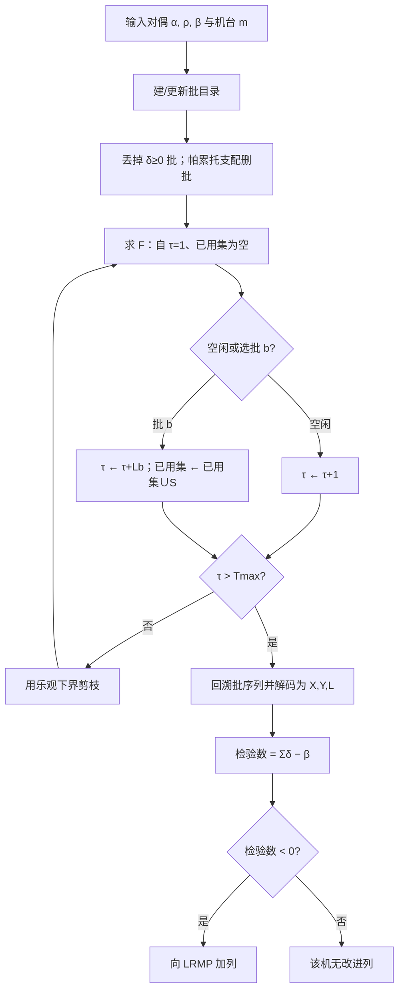
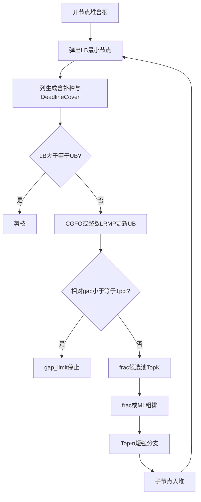

# 方法说明与数值实验结果

> 章节结构按 `result_analyze_framework.md` 编排。  
> 术语约定：**当前最好可行解** = 搜索中已找到的最小可行整数目标值，用作上界（UB）；**下界（LB）** 来自列生成 / 分支树对偶界；相对间隙 $\mathrm{gap}=(UB-LB)/UB$。  
> **检验数**（列生成文献中的 reduced cost）：列相对当前对偶解的净改进量；检验数 $<0$ 表示该列可改进主问题。

本批方法设定：$U=5$，$M=5$；BPC 侧为精确 EBRP；割平面仅 **Deadline Cover**；上界仅 **CGFO + 整数 LRMP**。  
分支：**`ml`（推荐）** = frac Top-$K$ 候选池 → LightGBM 粗排 → Top-$n$ 短强分支；**`frac_sb`** 为同一精修框架下的无学习消融（按 frac 粗排）。数值实验为 **IM · BPC-frac · BPC-ML** 三方对照。  
停机：时限 **或** 相对间隙 $\mathrm{gap}=(UB-\mathrm{tree\_LB})/UB\le 1\%$（BPC 的 $\mathrm{tree\_LB}$ 为开节点 LB 最小值；IM 用 Gurobi `MIPGap=0.01`）。  
§4.3 说明 ML 设计 / 训练 / 与 frac 的关系；§5 汇总中规模 15 例与大规模 15 例（全表 `all_results_im_frac_ml.md`）。§5.3 小规模本批未重跑。

---

## 1. 问题背景

航空复合材料制造中，热压罐固化是典型的**配置依赖装箱过程**：同一罐在同一时刻只能按一种固化配置开工；匹配该配置的工件可合批装入，占罐时长由合批内加工时间决定；罐与罐之间通过物料去向与库存—缺货决策耦合。

Hao et al.（*European Journal of Operational Research*, 2022）提出将装箱与多级批量规模集成的整数规划（IM），并用 Dantzig–Wolfe 分解 + 列生成求紧下界，子问题用双层动态规划（BLDP：先背包最优批，再时序路由）精确求解。

本仓库问题在同一工业背景下，采用**单件 WIP、进罐时间窗与报废**等设定，建立集成模型 IM；求解上沿用“主问题 + 单机定价子问题”的分解，定价算法为 **EBRP**（Exact Batch Routing Pricing，对应 BLDP 的批—路由思想并适配单件唯一性）；整数化采用 **分支—定价—割平面（BPC）**，分支点由 **机器学习（LightGBM LambdaRank）** 排序选取。对比基线为 Gurobi 直接求解 IM。

---

## 2. 数学模型

### 2.1 符号

下文集合大写、参数小写、决策变量大写。成品入库按**单件** $lt_{it}$ 推算（$t'=t+lt_{it}-1$）；合批占罐跨期 $L=\max lt$ 仅用于机台不重叠。实现中无显式完工指示变量 $C$。

#### 2.2.1 集合与索引

| 符号 | 含义 |
|------|------|
| $T$ | 离散计划时段集合 |
| $I$ | 单件物料集合（每件 1 单位 WIP） |
| $U$ | 固化配置集合 |
| $M$ | 热压罐集合 |
| $I_u=\{i\in I:u(i)=u\}$ | 配置 $u$ 可加工的物料集 |
| $I_m=\{i\in I:b_{im}=1\}$ | 机台 $m$ 可加工的物料集 |
| $M_i=\{m\in M:b_{im}=1\}$ | 物料 $i$ 允许加工的机台集 |

#### 2.2.2 已知参数

| 符号 | 含义 |
|------|------|
| $u(i)\in U$ | 物料 $i$ 的固化配置 |
| $rel_i,end_i$ | 物料 $i$ 最早 / 最晚开工时段 |
| $d_{it}\in\{0,1\}$ | 物料 $i$ 在时段 $t$ 的需求 |
| $lt_{it}$ | 物料 $i$ 在 $t$ 开工时的占罐时段数 |
| $v_i$ | 工装（托盘）长度 |
| $q_m$ | 热压罐 $m$ 容量 |
| $b_{im}\in\{0,1\}$ | 物料 $i$ 是否可在机 $m$ 加工 |
| $hc_i,bc_i,rc_i$ | 持货、缺货、报废成本 |
| $pc_{mu}$ | 机 $m$ 上配置 $u$ 的 setup / 生产成本 |
| $w_i$ | WIP 量（本批算例均为 1） |
| $\bar M$ | 足够大的常数（Big-M） |

#### 2.2.3 决策变量

| 符号 | 类型 | 含义 |
|------|------|------|
| $X_{imt}$ | $\{0,1\}$ | 物料 $i$ 是否在机 $m$、期 $t$ 开工 |
| $Y_{umt}$ | $\{0,1\}$ | 机 $m$ 是否在期 $t$ 对配置 $u$ 新开 setup |
| $L_{umt}$ | $\mathbb{Z}_+$ | $(m,t)$ 上配置 $u$ 本次 setup 的占罐跨期 |
| $R_i$ | $\{0,1\}$ | 物料 $i$ 是否报废 |
| $S_{it}^+,S_{it}^-$ | $\{0,1\}$ | 库存 / 缺货 |
| $Q_{mk}$ | $\ge 0$（松弛）或 $\{0,1\}$ | DW 主问题中机 $m$ 上第 $k$ 列的权重 |

#### 2.2.4 集成模型（Integrated Model）

**目标函数**

$$
\min\ 
\sum_{i\in I}\sum_{t\in T}hc_i S_{it}^+
+\sum_{i\in I}\sum_{t\in T}bc_i S_{it}^-
+\sum_{m\in M}\sum_{u\in U}\sum_{t\in T}pc_{mu}Y_{umt}
+\sum_{i\in I}rc_i R_i.
$$

**约束**

**(IM-1) 成品流平衡**

$$
S_{i,t-1}^+-S_{i,t-1}^-
+\sum_{m\in M}\sum_{\substack{t'\in T\\ t'+lt_{i,t'}-1=t}}X_{imt'}
=d_{it}(1-R_i)+S_{it}^+-S_{it}^-
\quad\forall i\in I,\,t\in T.
$$

**(IM-2) 每机每期至多一种新开配置**

$$
\sum_{u\in U}Y_{umt}\le 1\quad\forall m\in M,\,t\in T.
$$

**(IM-3) 开始生产双向绑定**

$$
\sum_{i\in I_u}X_{imt}\le |I_u|Y_{umt},\qquad
Y_{umt}\le\sum_{i\in I_u}X_{imt}
\quad\forall u\in U,\,m\in M,\,t\in T.
$$

**(IM-4) 配置匹配**

$$
X_{imt}\le Y_{u(i),m,t}\quad\forall i\in I,\,m\in M,\,t\in T
\text{（仅在可行开工点建立）}.
$$

**(IM-5) 跨期下界与 setup 联动**

$$
L_{umt}\ge lt_{it}X_{imt}\quad\forall u,\,i\in I_u,\,m,\,t;
\qquad
L_{umt}\le\bar M\,Y_{umt}\quad\forall u,\,m,\,t.
$$

**(IM-6) 机台不重叠**（$t'>t$）

$$
L_{umt}-\bar M\,(2-Y_{umt}-Y_{u',m,t'})\le t'-t
\quad\forall m,\,u,u',\,t'>t.
$$

**(IM-7) 容量（开工时刻装箱）**

$$
\sum_{i\in I_m}v_i X_{imt}\le q_m\quad\forall m\in M,\,t\in T.
$$

**(IM-8) 单件去向**

$$
\sum_{m\in M_i}\sum_{t:rel_i\le t\le end_i}X_{imt}+R_i=1\quad\forall i\in I.
$$

**(IM-9) 时间窗 / 专属机台 / 期末**  
不可行 $(i,m,t)$ 固定 $X_{imt}=0$。

#### 2.2.5 Dantzig–Wolfe 分解模型

按机台 $m\in M$ 分解：列 $k\in\mathcal{K}_m$ 为机 $m$ 上一个可行生产计划，参数为 $x^k,y^k,c_m^k,a_{i,t}^k,w_i^k$（开工、setup、setup 成本、完工入库、窗内开工量）。跨罐耦合仅通过库存流与物料去向留在主问题。

##### （1）主问题（限制主问题 LRMP）

**目标**

$$
\min\sum_{i,t}hc_i S_{it}^++\sum_{i,t}bc_i S_{it}^-+\sum_i rc_i R_i
+\sum_{m\in M}\sum_{k\in\mathcal{K}_m}c_m^k Q_{mk}.
$$

**约束**

**(LRMP-1) 成品流平衡**（对偶 $\alpha_{i,t}$）

$$
\sum_{m,k}a_{i,t}^k Q_{mk}+S_{i,t-1}^+-S_{i,t-1}^--S_{it}^++S_{it}^-
=d_{it}(1-R_i)
\quad\forall i\in I,\,t\in T.
$$

**(LRMP-2) 单件去向**（对偶 $\rho_i$）

$$
\sum_{m,k}w_i^k Q_{mk}+R_i=w_i\quad\forall i\in I.
$$

**(LRMP-3) 每机至多一列**（对偶 $\beta_m$）

$$
\sum_{k\in\mathcal{K}_m}Q_{mk}\le 1\quad\forall m\in M.
$$

**(LRMP-4) 变量域**：$Q_{mk}\ge 0$，$S_{it}^+,S_{it}^-,R_i\ge 0$（分支 / 切平面另加行，见第 4 节）。

列 $k$ 在机 $m$ 上的**检验数**：

$$
\bar c_m^k=c_m^k-\beta_m-\sum_i\rho_i w_i^k-\sum_{i,t}\alpha_{i,t}a_{i,t}^k.
$$

若 $\bar c_m^k<0$，则将该列加入主问题可改进当前 LRMP。

##### （2）子问题（单机定价）

固定机台 $m$。决策变量为 $X_{imt}$（$i\in I_m$）、$Y_{umt}$、$L_{umt}$；不含主问题的 $S_{it}^\pm$、$R_i$（报废与库存—缺货由主问题处理）。

**目标函数**（最小化该机列的检验数）

$$
\min\ 
\sum_{u\in U}\sum_{t\in T}pc_{mu}Y_{umt}
-\beta_m
-\sum_{i\in I_m}\rho_i\sum_{\substack{t\in T\\ rel_i\le t\le end_i}}X_{imt}
-\sum_{i\in I_m}\sum_{t\in T}\alpha_{i,\,t+lt_{it}-1}\,X_{imt}.
$$

**约束**

**(子-1) 每期至多一种新开配置**

$$
\sum_{u\in U}Y_{umt}\le 1\quad\forall t\in T.
$$

**(子-2) 开始生产双向绑定**

$$
\sum_{i\in I_u\cap I_m}X_{imt}\le |I_u\cap I_m|\,Y_{umt},
\qquad
Y_{umt}\le\sum_{i\in I_u\cap I_m}X_{imt}
\quad\forall u\in U,\,t\in T.
$$

**(子-3) 配置匹配**

$$
X_{imt}\le Y_{u(i),m,t}
\quad\forall i\in I_m,\,t\in T
\text{（仅在可行开工点建立）}.
$$

**(子-4) 跨期下界与 setup 联动**

$$
L_{umt}\ge lt_{it}X_{imt}
\quad\forall u\in U,\,i\in I_u\cap I_m,\,t\in T,
$$

$$
L_{umt}\le\bar M\,Y_{umt}
\quad\forall u\in U,\,t\in T.
$$

最优解中 $L_{umt}=\max\{lt_{it}:i\in I_u\cap I_m,\,X_{imt}=1\}$（无开工时为 0）。

**(子-5) 机台不重叠**（$t'>t$）

$$
L_{umt}-\bar M\,(2-Y_{umt}-Y_{u',m,t'})\le t'-t
\quad\forall u,u'\in U,\,t,t'\in T,\,t'>t.
$$

**(子-6) 容量（开工时刻装箱）**

$$
\sum_{i\in I_m}v_i X_{imt}\le q_m\quad\forall t\in T.
$$

**(子-7) 时间窗与计划期末可行**

$$
X_{imt}=0
\quad\text{若 }t<rel_i\text{ 或 }t>end_i\text{ 或 }t+lt_{it}-1>|T|.
$$

**(子-8) 可加工关系**

$$
X_{imt}=0\quad\forall i\notin I_m,\,t\in T
\quad\text{（本子问题变量本身只对 }i\in I_m\text{ 定义）}.
$$

**(子-9) 本机每件至多开工一次**

$$
\sum_{t\in T}X_{imt}\le 1\quad\forall i\in I_m.
$$

任一满足（子-1）–（子-9）的 $(X,Y,L)$ 对应一列 $k\in\mathcal{K}_m$。若子问题最优目标值（检验数）$<0$，将该列加入 LRMP。

---

## 3. 列生成算法

### 3.1 子问题结构分析

子问题需同时决定：**何时开何种配置的 setup**，以及**每个 setup 装哪些单件**。参照 Hao et al.：一旦某期 $Y_{ut}=1$，该期装箱在最优解中必为对应背包问题的最优解；多期 setup 序列则可视为时间轴上的路由。

本设定下进一步有：

- 有效物料集为 $I_m$，其规模决定定价难度；
- 合批跨期 $L_b=\max_{i\in S}lt_{i\tau}$，路由“弧长”可变；
- 约束（子-9）要求每件至多开工一次，故排程过程中必须记住**哪些物料已经用过**，不能只用“固定跨期 $l_u$ 的简单路径 DP”。

因此子问题等价于：在批目录上求一条物料不交、时段不重叠的批序列，使检验数最小。

### 3.2 子问题求解方法

本批实验仅用**精确 EBRP**（`ebrp_force=True`）。

#### 3.2.1 EBRP 基本逻辑

与论文 BLDP 同构的两层思想：

1. **批层**：生成可行批 $b=(u,\tau,S)$，批的边际贡献
   $$
   \delta_b=pc_{mu}-\sum_{i\in S}\bigl(\rho_i+\alpha_{i,\tau+lt_{i\tau}-1}\bigr)
   $$
   （分支 / 切平面对偶可再修正）。$\delta_b$ 是“开这一批相对对偶价格的净代价”。
2. **路由层**：在时间轴上串联互不重叠、物料不交的批，最小化 $\sum\delta_b$，再减去 $\beta_m$，得到该机列的检验数。

与论文 UKP（件数可为多）的差异：此处每件 0-1；第二层动态规划的状态除当前时刻外，还要用一个集合记录已用工件。

**帕累托支配（批目录剪枝）**  
同一开工点上往往枚举出许多批。对固定机台、在同一比较单元内（实现中按配置—时段单元，展平后也按时段再剪一次），若批 $A=(u,\tau,S_A)$ 与批 $B=(u',\tau,S_B)$（同开工时刻）满足

$$
S_A\subseteq S_B,\qquad
L_A\le L_B,\qquad
\delta_A\le\delta_B,
$$

则称 **$A$ 帕累托支配 $B$**：$A$ 用的物料不多于 $B$、占罐不长于 $B$、边际代价不劣于 $B$。此时任意含 $B$ 的最优路由都可把 $B$ 换成 $A$（或更优），故可从目录中**删除 $B$ 而不损失最优检验数**。实现见 `_prune_batch_cell`：按 $(L,|S|,\delta)$ 排序后做上述检验。另：$\delta_b\ge 0$ 的批对最小化检验数无帮助，也直接丢弃。

**记号（后文命题共用）**  
记 $T=\{1,\ldots,T_{\max}\}$。对已排物料集合 $U\subseteq I_m$，实现中常用长度为 $|I_m|$ 的 0-1 向量（**位图 / bitset**）编码：第 $i$ 位为 1 表示物料 $i$ 已排过。这只是集合 $U$ 的计算机表示，**不是**给物料重新编号；下文一律用集合符号 $U$，称为**已用物料集**。

批 $b=(u,\tau,S)$ 可行是指：满足容量与时间窗，$L_b=\max_{i\in S}lt_{i\tau}$，且可由（子-1）–（子-9）导出；目录中仅保留未被帕累托支配、且 $\delta_b<0$ 的批。列对应批序列 $\mathcal{B}=(b_1,\ldots,b_K)$，检验数为

$$
\bar c(\mathcal{B})=\sum_{k=1}^{K}\delta_{b_k}-\beta_m.
$$

#### 3.2.2 EBRP 最优性相关证明

**引理（帕累托删批安全）**  
若 $A$ 帕累托支配 $B$（同上：$S_A\subseteq S_B$，$L_A\le L_B$，$\delta_A\le\delta_B$），则存在最优批序列不含 $B$。

*证明.* 若某可行序列使用了 $B$，将 $B$ 换成 $A$：物料集变小或不变，故与后续批仍可不交；占罐不变更长，故与前后批仍可不重叠；$\delta$ 不增，故总检验数不劣。反复替换后得到不含被支配批的最优序列。因此删去被支配批不改变最优值。□

**命题 1（批表示与子问题等价）**  
设 $(X,Y,L)$ 满足上文子问题的全部约束（子-1）–（子-9）。则存在唯一的批序列 $\mathcal{B}$，使得：

1. 每个 $Y_{u\tau}=1$ 对应恰好一批 $b=(u,\tau,S)$，其中 $S=\{i\in I_m:X_{i\tau}=1\}$，$L_b=L_{u\tau}$；
2. 各批占罐区间互不重叠，且不同批的 $S$ 两两不交；
3. $\bar c(\mathcal{B})$ 等于该 $(X,Y,L)$ 在子问题目标函数中的取值。

反之，任一满足不重叠与物料不交的可行批序列也可还原为满足（子-1）–（子-9）的 $(X,Y,L)$。

*证明.*  
（⇒）由（子-1），每个时段至多一个配置的 $Y_{u\tau}=1$。对每个这样的 $(u,\tau)$，令 $S=\{i:X_{i\tau}=1\}$。由（子-2）（子-3），$S\subseteq I_u\cap I_m$ 且 $S\neq\varnothing$。由（子-4），$L_{u\tau}\ge\max_{i\in S}lt_{i\tau}$；在最优解中等式成立，记 $L_b=L_{u\tau}$。由（子-6）（子-7）得批可行。由（子-5），若另有 $Y_{u'\tau'}=1$ 且 $\tau'>\tau$，则 $\tau'\ge\tau+L_{u\tau}$，即批不重叠。由（子-9），同一 $i$ 不可能出现在两个开工时段，故批间 $S$ 不交。将所有 setup 按开工时刻排序即得 $\mathcal{B}$。  

目标函数中 $\sum pc_{mu}Y_{umt}$ 按批相加即为 $\sum_b pc$；$\rho,\alpha$ 项按单件开工与完工时刻计入，与 $\sum_b\sum_{i\in S}(\rho_i+\alpha_{i,\tau+lt_{i\tau}-1})$ 一致，故目标值 $=\sum_b\delta_b-\beta_m=\bar c(\mathcal{B})$。  

（⇐）对批序列中每一批置 $Y_{u\tau}=1$、$X_{i\tau}=1$（$i\in S$）、$L_{u\tau}=L_b$，其余为 0，直接验证（子-1）–（子-9）。□

**命题 2（动态规划递推给出最优检验数）**  

定义值函数 $F(\tau,U)$（$\tau\in\{1,\ldots,T_{\max}+1\}$，$U\subseteq I_m$）为：  
在**当前最早可开工时刻为 $\tau$**、**集合 $U$ 中的物料已经排过（不可再用）** 的前提下，从该状态排到计划期末所能达到的**最小批边际成本和** $\sum\delta$（尚未减 $\beta_m$）。边界条件：

$$
F(T_{\max}+1,U)=0\quad\forall U\subseteq I_m.
$$

对 $\tau\le T_{\max}$，决策只有两类——（i）时段 $\tau$ 空闲，转到 $(\tau+1,U)$；（ii）在 $\tau$ 选一可行批 $b=(u,\tau,S)$，要求 $S\cap U=\varnothing$，转到 $(\tau+L_b,\,U\cup S)$ 并支付 $\delta_b$。故

$$
F(\tau,U)
=\min\Biggl\{
F(\tau+1,U),\ 
\min_{\substack{b=(u,\tau,S)\\ S\cap U=\varnothing}}
\bigl[\delta_b+F(\tau+L_b,\,U\cup S)\bigr]
\Biggr\}.
$$

（若无可行批，第二项视为 $+\infty$。）

则子问题最优检验数等于 $F(1,\varnothing)-\beta_m$。也就是说：从“时刻 1、尚未用任何物料”出发，按上述最优递推得到的值，再减 $\beta_m$，就是子问题的最优目标。

说明：动态规划里“当前状态的最优值 = 对所有合法一步决策取最优，再加后继状态最优值”这一原理，常称为 **Bellman 最优性原理**；上式正是该原理在本问题上的具体写法，并非另引入一个新对象。

*证明.*  
对 $\tau$ 从 $T_{\max}+1$ 递减到 $1$ 做归纳。  

当 $\tau=T_{\max}+1$ 时已无时段可排，成本和为 0，与边界一致。  

设对所有 $\tau'>\tau$、一切 $U$，断言“$F(\tau',U)$ 等于该状态下的最小剩余成本和”已成立。在状态 $(\tau,U)$：任一可行续排方案的第一步要么空闲，要么选某批 $b$。若空闲，剩余最优成本和为 $F(\tau+1,U)$（归纳假设）。若选 $b$，则立即支付 $\delta_b$，且后继状态为 $(\tau+L_b,U\cup S)$，其最优剩余为 $F(\tau+L_b,U\cup S)$（归纳假设）；因 $L_b\ge 1$，有 $\tau+L_b>\tau$。对所有合法第一步取最小，恰得递推式右端，故 $F(\tau,U)$ 为该状态最优值。  

特别地，$F(1,\varnothing)$ 是“从计划期初、未用任何物料”的最小 $\sum\delta$。由命题 1，这等价于在全部可行 $(X,Y,L)$ 上最小化子问题目标中除 $-\beta_m$ 外的部分，因而最优检验数为 $F(1,\varnothing)-\beta_m$。□

**命题 3（乐观下界剪枝不损失最优性）**  

命题 2 中的 $F(\tau,U)$ 即“从状态 $(\tau,U)$ 起的最小剩余批成本和”。实现中另算一个**更松的下界** $\underline{\ell}(\tau)$：忽略“物料不可重复”等耦合，只按时刻累加“该时刻最负的批 $\delta$（若全非负则取 0）”。于是对任意已用集 $U$，

$$
\underline{\ell}(\tau)\ \le\ F(\tau,U).
$$

因此，若搜索中已支付的部分成本和为 $\pi$，且 $\pi+\underline{\ell}(\tau)-\beta_m$ 已不低于当前最好检验数（或已 $\ge 0$ 因而得不到负检验数列），则可剪掉该分支而**不会删掉真正的最优解**。

*证明.* $\underline{\ell}$ 对应的可行域不小于原问题（允许“重复用物料”等），最小值只可能更小（更负或相等），故 $\underline{\ell}(\tau)\le F(\tau,U)$。若 $\pi+\underline{\ell}(\tau)$ 已不能改进，则更紧的 $\pi+F(\tau,U)$ 也不能改进。□

#### 3.2.3 EBRP 算法流程图



列生成外环：解 LRMP → 各机并行 EBRP → 加入检验数 $<0$ 的列 → 直至无负检验数列；有效下界 $\mathrm{LB}=\mathrm{LRMP}+\sum_m\min\{\eta_m^*,0\}$，其中 $\eta_m^*$ 为机 $m$ 子问题最优检验数。

## 4. 分支定价割框架

### 4.1 割平面类型

当前实现**仅启用 Deadline Cover**（`tight_deadline=True` 收紧右端）。WIP Process LB、Setup Pair、同机同期 setup 割、以及窄间隙 Gomory 报废取整均已关闭（`merge_cut_options` 强制关掉；`reinforce_with_cuts` 为空操作）。

#### 截止期覆盖不等式（Deadline Cover）

**含义**：对每个出现过的截止时刻 $\tau$，凡是必须在 $\tau$ 及以前完工入库的物料集合 $I(\tau)$，它们在 $\tau$ 之前的**总完工件数**不能超过系统在 $[1,\tau]$ 内物理上能装下并完工的件数上界。该上界就是不等式的右端 **RHS（Right-Hand Side）**。

记

$$
I(\tau)=\{i\in I:end_i\le\tau\}.
$$

对机 $m$ 上第 $k$ 列，令 $a_k(\tau)$ 为该列使 $I(\tau)$ 中物料**完工时刻 $\le\tau$** 的件数之和（实现中按列的开工与提前期推算到达期）。主问题加约束：

$$
\sum_{m\in M}\sum_{k\in\mathcal{K}_m}a_k(\tau)\,Q_{mk}\ \le\ \mathrm{RHS}(\tau).
$$

- **左端**：分数解下，“$\tau$ 前完工的 $I(\tau)$ 件数”的凸组合。  
- **右端 $\mathrm{RHS}(\tau)$**：不依赖列池，只由容量、托盘长度与最短占罐时长估算的**可行完工件数上界**。

#### RHS 怎么算（tight deadline）

实现见 `deadline_cover_rhs`（`lrmp_cuts.py`）。对固定 $\tau$ 与 $I(\tau)$：

1. 取 $I(\tau)$ 中最大托盘长 $v^{\max}=\max_{i\in I(\tau)}v_i$（最“占地方”的件，用来估单次 setup 最多几件）；  
2. 取全体配置最短占罐时长 $\ell^{\min}=\min_u \ell_u$（最短一次 setup 占用几个时段）；  
3. 到时刻 $\tau$ 前，单机最多不相交 setup 次数  
   $$
   S(\tau)=\max\bigl(1,\ \lfloor\tau/\ell^{\min}\rfloor\bigr);
   $$  
4. 机 $m$ 每次 setup 最多托盘数（件数）$\mathrm{trays}_m=\lfloor q_m/v^{\max}\rfloor$；  
5. 汇总各机：
   $$
   \mathrm{RHS}(\tau)=\sum_{m\in M}S(\tau)\cdot\mathrm{trays}_m.
   $$

直观理解：每台机最多开 $S(\tau)$ 次罐，每次最多装 $\mathrm{trays}_m$ 件，乘起来再对机台求和，就是 $\tau$ 前最多能“覆盖”多少件必须在 $\tau$ 前完工的物料。用 $v^{\max}$ 而不是 $\min v_i$，会得到**更小（更紧）**的 RHS，因此叫 tight deadline。

主问题对每个不同的 $end_i$ 值各建一条上述割；列加入主问题时，把对应的 $a_k(\tau)$ 写进左端系数。

#### 数值例子

设 $|M|=2$，$q_1=q_2=10$，$\ell^{\min}=4$，截止 $\tau=12$。  
$I(12)$ 中 6 件物料的托盘长分别为 $3,3,4,4,5,5$，故 $v^{\max}=5$。

则

$$
S(12)=\lfloor 12/4\rfloor=3,\qquad
\mathrm{trays}_m=\lfloor 10/5\rfloor=2\quad(m=1,2),
$$

$$
\mathrm{RHS}(12)=3\cdot 2+3\cdot 2=12.
$$

即：两台机到时段 12 前合计最多完工 **12** 件“截止 $\le 12$”的物料。

若某分数解中，两台机各选了列，使 $I(12)$ 在 $\tau=12$ 前完工件数的凸组合为

$$
0.6\cdot 8+0.4\cdot 7\;+\;0.5\cdot 6+0.5\cdot 5=4.8+5.5=10.3\le 12
$$

（可行）；若左端算得 $12.5$，则违反 Deadline Cover，割平面起作用，逼迫解减少过早/过多对 $I(12)$ 的完工分配，或换列。

对比：若不用 tight、改用全体最小托盘 $v^{\min}=3$，则 $\mathrm{trays}_m=\lfloor 10/3\rfloor=3$，$\mathrm{RHS}=3\cdot 3\cdot 2=18$，上界更松，割更弱。本批实验开启 tight，因此用 $v^{\max}$ 这一套。

### 4.2 分支类型

由 LRMP 解诱导分数量。记

$$
\hat Y_{umt}=\sum_k y_{umt}^k Q_{mk},\quad
W_i=\sum_{m,k}w_i^k Q_{mk},\quad
\hat R_i=R_i\text{（主问题变量）}.
$$

三类分支共用同一候选池，由 §4.3 的 **frac Top-$K$ + Top-$n$ 短强分支**选出一个再展开左右子节点。

#### （1）Setup 分支（问题特异性最强）

若 $\hat Y_{umt}\notin\{0,1\}$，生成：

- 一侧：$Y_{umt}=0$（定价删该 setup；列池去掉含该 setup 的列）；
- 另一侧：$Y_{umt}=1$（常延后处理）。

**例**：$\hat Y_{2,0,5}=0.47$，分支为强制不开 / 强制开该 setup。

#### （2）WIP 分支（时间窗过程量）

若 $W_i\notin\mathbb{Z}$，令 $\ell=\lfloor W_i\rfloor$，$c=\lceil W_i\rceil$，生成 $W_i\le\ell$ 与 $W_i\ge c$。

**例**：$W_i=0.6\Rightarrow W_i\le 0$ 或 $W_i\ge 1$（本批 $w_i=1$ 时即“本窗不加工” vs “必须加工”）。

#### （3）报废分支

若 $\hat R_i\notin\{0,1\}$，生成 $R_i=1$ 与延后的 $R_i=0$。

- $R_i=1$：主问题加 $R_i\ge 1$；
- $R_i=0$：主问题加 $R_i\le 0$（结合 WIP 平衡 $R_i+W_i=w_i$，即强制窗内加工量 $W_i=w_i$）。

**例**：$R_i=0.35\Rightarrow$ 强制报废 / 强制不报废。

#### 强制侧列池与补种

对强制侧（$Y=1$、$W\ge$、$R=0$），子节点**继承**父节点列池（按 $Y$ 过滤），并在进入正式 CG 前做**覆盖性补种**：对需覆盖加工的物料抬高 WIP 对偶 $\rho$，用定价生成含这些物料的列，使 LRMP 先可行再迭代。$Y=1$ 侧另用规范定价补全 forced setup 列。若首轮主问题仍不可行，再补种一次（至多一次）。

### 4.3 分支选择：frac 短 SB 与 ML 粗排 + 短 SB

二者**共用同一套候选池与短强分支（SB）精选**；差别只在「谁决定哪 $n$ 个候选进入昂贵的短 SB」。

```text
枚举分数候选
    → frac Top-K（默认 K=20）形成候选池
        →【粗排】frac_sb：按 frac 取 Top-n
                 ml：LightGBM 打分取 Top-n
            → Top-n 短 SB（左右短时 CG，取 y_min 最大者开枝）
```

因此：**ML 不是替代强分支，而是替代「按分数程度粗排」**；最终开枝仍由短 SB 的 $y_{\min}$ 决定。`frac_sb` 是无学习消融基线；正式求解推荐 `ml`。

#### 4.3.1 候选池（frac Top-$K$）——两者相同

1. 枚举当前节点所有分数的 setup / WIP / scrap；  
2. 对每个候选计算 $\mathrm{frac}=\min(f,1-f)$（越接近 $0.5$ 越大）；  
3. 跨类型按 $\mathrm{frac}$ 降序保留 **Top-$K$**（默认 $K=20$）。

#### 4.3.2 短强分支精选（Top-$n$）——两者相同

对粗排得到的 Top-$n$（默认 $n=5$）每个候选：左右各跑短时 CG，得 $\Delta_L,\Delta_R$，取 $y_{\min}=\min(\Delta_L,\Delta_R)$ 最大者开枝。墙钟不足则跳过精选，直接用粗排第一。

示意（Top-3 入精选）：

| 候选 | frac | 类型 | $\Delta_L$ | $\Delta_R$ | $y_{\min}$ |
|------|------|------|------------|------------|------------|
| $Y_{u_1 m_2 t_8}=0.48$ | 0.48 | setup | 12.0 | 40.0 | 12.0 |
| $W_5=0.55$ | 0.45 | WIP | 35.0 | 28.0 | **28.0** |
| $R_9=0.30$ | 0.30 | scrap | 5.0 | 80.0 | 5.0 |

→ 选 $W_5$（$y_{\min}$ 最大）。`frac_sb` 若只看 frac 会优先 $Y$；ML 的目标正是更常把这种「SB 真优」留进 Top-$n$。

#### 4.3.3 ML 分支：特征、标签与训练

**设计目标**：在 frac Top-$K$ 池内，用廉价模型预测「短 SB 会看好谁」，把真正值得精修的变量排进 Top-$n$，减少漏掉好分支、同时控制短 SB 次数（仍为 $n$ 次）。

**特征（v6，共 9 维，尺度无关）**

| 特征 | 含义 |
|------|------|
| `frac` | $\min(f,1-f)$ |
| `is_y` / `is_wip` / `is_scrap` | 分支类型 one-hot |
| `dual_share` | 候选 dual / 池内 dual 之和 |
| `dens_rel` | 相对密度 dens / 池内 max dens |
| `prox_pen` | 邻近惩罚，截断到 $[0,1]$ |
| `dual_rank` / `frac_rank` | 池内 dual、frac 名次（归一化） |

**标签**：离线在采集节点上对候选做短 SB，取两侧 LB 增益的保守侧 $y_{\min}$（再经稳健标准化）；相关性标签供 LambdaRank 使用。主键为 **`y_min`**（与线上短 SB 评分一致）。

**采集与训练设定（v7）**

- 数据：与 §5.1 **同一套**生成规则（`apply_bench_generation()`：窗长 `length_range`$=[12,16]$、LT$\in\{5..10\}$、就绪 `rel_frac`$=[0.1,0.5]$），规模网格含 xs/s/小/中/大；目录 `ml_train_data_v7_w1216`；约 **688** 个 query / **639** 个有效组（经相对增益过滤）。  
- 模型：LightGBM **LambdaRank**；按 query 划分约 70% / 15% / 15% train/val/test；以 val 上 R@5（兼顾 NDCG@5）选超参。  
- 线上：$n=\texttt{ML\_SB\_REFINE\_K}=5$，模型文件 `ml_branch_model.txt`。

**离线训练效果（终训，test 97 组）**

| 指标 | ML（选中 `ndcg5_deep`） | frac 基线（同 test） |
|------|------------------------:|---------------------:|
| R@5（SB 最优落入 Top-5 的比例） | 0.701 | 0.701 |
| R@3 | 0.567 | 0.546 |
| NDCG@5 | 0.572 | — |

说明：终训上 R@5 与纯 frac 粗排打平，R@3 略优——即「把 SB 最优留进 Top-5」的频率与 frac 相当，但排序更靠前略好。线上 BPC 仍常快于 `frac_sb`，因为粗排改变了**树搜索路径**（何时抬 LB、何时找 UB），不只取决于离线 R@5；难例上收益更大，易例可能略慢（短 SB 开销相近、路径不同）。

#### 4.3.4 frac 与 ML 的关系（小结）

| | `frac_sb` | `ml` |
|--|-----------|------|
| 候选池 | frac Top-$K$ | **相同** |
| 粗排 | 按 `frac` | LightGBM 对池内打分 |
| 精选 | Top-$n$ 短 SB | **相同** |
| 角色 | 无学习基线 / 消融 | 推荐正式策略 |
| 依赖 | 无模型文件 | 需 `ml_branch_model.txt` |

二者是 **「同一精修框架下的两种粗排」**，不是两套互斥分支类型。

### 4.4 上界方法

维护标量 **当前最好可行解 UB**；仅以下两种途径更新（取更优者）：

| 方法 | 时机 | 做法 |
|------|------|------|
| **CGFO** | 根节点一次；非根节点在剩余时间充足时 | 由分数列支撑构造允许的 $Y$，其余压 0，再解受限 IM（Hao et al. CGFO 思想） |
| **整数 LRMP** | 任一节点 | 若诱导 $\hat Y$、$Q$、$R$ **全部已整数**，则 LRMP 目标值本身就是可行整数解，直接作为 UB |

已去掉：根/节点 RMP-IP、根完整 IM、贪心取整 IM、节点附近 IM、终局 IM。搜索结束时**保留过程中最好的 UB**，不再额外抛光。

说明：`root_im` / `final_im` / `use_node_im` 参数仍保留在接口中，但上界路径不再使用它们。

### 4.5 分支定价割总体流程

**概述**：每个节点列生成得 LB（强制侧可补种）；用 CGFO / 整数 LRMP 更新 UB；分数则按 frac Top-$K$ →（可选 ML 粗排）→ Top-$n$ 短 SB 选 setup/WIP/报废分支；节点 CG 始终带 Deadline Cover；$\mathrm{LB}\ge\mathrm{UB}$ 剪枝；全局 $\mathrm{tree\_LB}=\min\{\text{开节点 LB}\}$，若 $(\mathrm{UB}-\mathrm{tree\_LB})/\mathrm{UB}\le\texttt{mip\_gap}$（默认 $1\%$）则停（状态 `gap_limit`）。证优仍要求开节点耗尽且全程无 CG 失败。



```
开节点堆 ← {根}；UB ← +∞
while 有开节点 且 未超时 且 未证优 且 未达 gap_limit:
    弹出 LB 最小节点 N
    列生成（继承列池；强制侧补种；Deadline Cover）→ LB(N)
    若 LB(N) ≥ UB → 剪枝
    用 CGFO / 整数 LRMP 更新 UB
    tree_LB ← min{开节点 LB 估计}
    若 UB 有限且 (UB − tree_LB)/UB ≤ mip_gap → 停止（gap_limit）
    若诱导 Y/Q/R 已整数 → 用 LRMP 目标更新 UB；不分支
    否则：frac Top-K →（ml：ML 粗排）→ Top-n 短 SB 选分支 → 子节点入堆
输出过程中最好的 UB、tree_LB、状态
```

---

## 5. 数值实验

实验对比三方：**IM**（Gurobi）、**BPC-frac**（`frac_sb`）、**BPC-ML**（`ml`）。全量逐例表见 [`all_results_im_frac_ml.md`](all_results_im_frac_ml.md)。

### 5.1 算例生成规则

统一 $U=5$，$M=5$，由 `SetConfig('small_cg', T, U, 0, I, M)` 与给定 seed 生成。三档 **只改 $T$、$I$、seed 与求解时限**；LT 与时间窗规则完全相同。

**共用参数**

| 参数 | 取值 | 说明 |
|------|------|------|
| LT（`BENCH_LEAD_TIME_CHOICES`） | $\{5,6,7,8,9,10\}$ | 各配置均匀抽取占罐基础时长 |
| 窗长 `length_range` | $[12,16]$ | **绝对时段**，小/中/大相同（不随 $T$ 变）；相对 LT 约有 $+7$ 松弛，避免窗$\approx$LT 导致过易 |
| 就绪 `rel_frac` | $[0.10,\,0.50]$ | $rel_i$ 落在 $[0.1T,\,0.5T]$（再截断使窗不越界） |

**分档规模**（难度靠 $T$、$I$ 拉开，不靠拉长窗）

| 档 | 实例 / 标识 | $T$ | $I$ | seed | 求解时限 |
|----|-------------|-----|-----|------|----------|
| 小 | 本批未列入对比 | 30 | 40 | — | 900s |
| 中 | `30101`–`30501`，`31101`–`32001`（共 15） | 35 | 50 | 见左列 | **1800s** |
| 大 | `40101`–`40501`，`41101`–`42001`（共 15） | 40 | 55 | 见左列 | **3600s** |

> 规模调整：原中(30,40)→现小；原大(35,50)→现中（IM 时限 1800s）；现大=(40,55)（IM 时限 3600s）。中/大各两批种子不重叠，下文按规模合并报告。

实现：`configuration.BENCH_*`、`BENCH_SMALL/MEDIUM/LARGE`、`apply_bench_generation()`；生成器对 `small_cg` 使用 `length_range` 与 `BENCH_LEAD_TIME_CHOICES`。

### 5.2 分支策略与求解设定

| 项 | 取值 |
|----|------|
| BPC-frac | `frac_sb`；$K=20$；$n=\texttt{FRAC\_SB\_REFINE\_K}=5$ |
| BPC-ML | `ml`；$K=20$；粗排后 $n=\texttt{ML\_SB\_REFINE\_K}=5$；模型 `ml_branch_model.txt`（v7） |
| 定价 | 精确 EBRP，`ebrp_force=True` |
| 割 | 仅 Deadline Cover（含 tight RHS） |
| 上界 | CGFO + 整数 LRMP |
| BPC 停机 | 时限，或 $(\mathrm{UB}-\mathrm{tree\_LB})/\mathrm{UB}\le 1\%$ |
| IM 停机 | 时限，或 Gurobi `MIPGap=0.01` |
| 全量汇总 | `all_results_im_frac_ml.md` |

节点选点（`ml`）：

```text
父节点 CG → 枚举分数候选 → frac Top-20 → ML 粗排 → Top-5 短强分支 → 开枝
```

### 5.3 小规模算例结果分析

时限 900s，规模 $(T,I)=(30,40)$。  
**本批未重跑小规模**，故此处不附数值表。

### 5.4 中规模算例结果分析

时限 1800s，$(T,I)=(35,50)$，种子 `30101`–`30501` 与 `31101`–`32001`（**共 15 例**）。表内为 gap% / 时间(s)；全字段见 `all_results_im_frac_ml.md`。

| seed | IM gap% | IM s | frac gap% | frac s | ML gap% | ML s |
|------|--------:|-----:|----------:|-------:|--------:|-----:|
| 30101 | 13.58 | 1801.3 | 0.77 | 26.7 | 0.75 | 55.0 |
| 30201 | 7.24 | 1801.3 | 0.91 | 26.9 | 0.91 | 37.2 |
| 30301 | 5.34 | 1801.8 | 0.84 | 47.0 | 0.79 | 37.6 |
| 30401 | 7.48 | 1801.4 | 0.98 | 1153.5 | 0.92 | 471.6 |
| 30501 | 7.44 | 1801.6 | 1.00 | 429.1 | 1.00 | 405.2 |
| 31101 | 6.22 | 1801.7 | 1.04 | 1800.1 | 0.99 | 1572.4 |
| 31201 | 10.41 | 1801.4 | 0.99 | 1748.9 | 1.00 | 856.0 |
| 31301 | 13.41 | 1801.5 | 2.55 | 1799.2 | 2.35 | 1800.3 |
| 31401 | 11.83 | 1801.3 | 1.00 | 440.3 | 1.00 | 408.8 |
| 31501 | 8.22 | 1801.3 | 1.00 | 1557.9 | 1.18 | 1799.2 |
| 31601 | 0.98 | 634.0 | 0.92 | 152.4 | 0.72 | 45.3 |
| 31701 | 5.83 | 1801.4 | 0.99 | 586.2 | 1.00 | 1178.1 |
| 31801 | 7.70 | 1801.2 | 1.58 | 1800.0 | 0.98 | 566.4 |
| 31901 | 8.88 | 1801.3 | 0.98 | 103.1 | 0.96 | 135.6 |
| 32001 | 5.06 | 1803.8 | 1.00 | 1801.2 | 1.00 | 1014.5 |
| **均值** | **7.97** | **1723.8** | **1.10** | **898.2** | **1.04** | **692.2** |
| **达1%** | **1/15** | | **12/15** | | **13/15** | |

**分析**：IM 多数满时限，均 gap≈8%。两种 BPC 把 gap 压到约 1%；**ML 相对 frac**：均时约少 206s（692 vs 898），均 gap 略紧，达 1% 多 1 例。易例上 ML 偶有略慢，难例（如 30401、31101、31801、32001）收益更明显。

### 5.5 大规模算例结果分析

时限 3600s，$(T,I)=(40,55)$，种子 `40101`–`40501` 与 `41101`–`42001`（**共 15 例**）。

| seed | IM gap% | IM s | frac gap% | frac s | ML gap% | ML s |
|------|--------:|-----:|----------:|-------:|--------:|-----:|
| 40101 | 14.53 | 3602.3 | 1.31 | 3600.5 | 0.96 | 1115.8 |
| 40201 | 10.85 | 3602.6 | 0.99 | 1839.0 | 1.00 | 2593.6 |
| 40301 | 15.43 | 3601.9 | 2.06 | 3602.6 | 1.12 | 3602.0 |
| 40401 | 8.28 | 3601.8 | 1.58 | 3602.5 | 1.31 | 3599.6 |
| 40501 | 7.34 | 3602.4 | 0.99 | 604.0 | 0.97 | 569.2 |
| 41101 | 13.41 | 3602.1 | 0.99 | 556.8 | 0.98 | 371.2 |
| 41201 | 14.88 | 3602.2 | 0.91 | 22.6 | 0.47 | 32.4 |
| 41301 | 9.58 | 3602.1 | 2.21 | 3600.9 | 1.38 | 3600.3 |
| 41401 | 6.95 | 3601.9 | 0.98 | 1045.6 | 0.99 | 721.7 |
| 41501 | 11.60 | 3602.2 | 1.81 | 3601.6 | 2.72 | 3600.7 |
| 41601 | 7.20 | 3601.8 | 1.42 | 3602.2 | 1.39 | 3601.3 |
| 41701 | 10.53 | 3602.4 | 0.99 | 395.4 | 0.98 | 541.1 |
| 41801 | 14.09 | 3602.6 | 1.00 | 204.8 | 0.91 | 220.4 |
| 41901 | 12.83 | 3602.9 | 0.96 | 65.2 | 0.94 | 96.4 |
| 42001 | 15.13 | 3602.3 | 0.99 | 863.8 | 0.98 | 1786.8 |
| **均值** | **11.51** | **3602.2** | **1.28** | **1813.8** | **1.14** | **1736.8** |
| **达1%** | **0/15** | | **9/15** | | **10/15** | |

**分析**：IM 15/15 满时限，均 gap≈11.5%。BPC 把 gap 压到约 1.1–1.3%；**ML 相对 frac**：均 gap 略紧（1.14 vs 1.28），达 1% 多 1 例，均时接近（1737 vs 1814）。新批中个别例（如 41501）ML 更慢/gap 更大，整体仍略优于或持平 frac。

### 5.6 初步结论和待改进点

**方法设定**

1. **割**：仅 Deadline Cover（含 tight RHS）。  
2. **分支**：setup / WIP / scrap；推荐 **`ml`**（frac Top-$K$ → ML 粗排 → Top-$n$ 短 SB）；`frac_sb` 作消融。  
3. **强制侧**：列池继承 + 覆盖性补种；`R=0` 施加 $R_i\le 0$。  
4. **上界**：仅 CGFO + 整数 LRMP。  
5. **停机**：时限或相对 gap $\le 1\%$。  

**全量 30 例倾向（中15 + 大15）**

| 方法 | mean gap% | mean time | 达1% |
|------|----------:|----------:|------|
| IM | 9.74 | 2663s | 1/30 |
| BPC-frac | 1.19 | 1356s | 21/30 |
| **BPC-ML** | **1.09** | **1215s** | **23/30** |

1. IM 远弱于两种 BPC（LB 松）。  
2. BPC-ML 相对 frac：**全量略优**（均 gap、均时、达 1%），不是数量级差距；详见 §5.7。  
3. 正式求解建议默认 **BPC-ML**；`frac_sb` 保留为无学习消融。

**待改进**

1. 补跑小规模 $(30,40)$@900s。  
2. 大规模未达 1% 的实例：加强早期 UB / 证优。  
3. 可选：过程中按 gap 进展在 `frac_sb` / `ml` 间自适应切换，减轻易例开销。

### 5.7 BPC-ML vs BPC-frac：分规模效率 / 效果与波动

以下基于同种子配对（中 15 + 大 15）。$\Delta$ 均指 **ML − frac**（gap 负=更好；时间负=更快）。统计量：均值、中位数、样本标准差 sd、极差 range$=\max-\min$、变异系数 CV$=\mathrm{sd}/\mathrm{mean}$。

#### （1）效果（gap%）

| 规模 | 方法 | 均值 | 中位数 | sd | min | max | 极差 | CV | 达1% | 配对 ML 更优 |
|------|------|-----:|-------:|---:|----:|----:|-----:|---:|-----:|------------:|
| 中 15 | frac | 1.10 | 0.99 | 0.44 | 0.77 | 2.55 | 1.78 | 0.40 | 12/15 | — |
| 中 15 | ML | **1.04** | 0.99 | **0.38** | 0.72 | 2.35 | **1.63** | 0.37 | **13/15** | **10/15** |
| 大 15 | frac | 1.28 | 1.00 | **0.44** | 0.91 | 2.21 | **1.30** | 0.34 | 9/15 | — |
| 大 15 | ML | **1.14** | 0.98 | 0.49 | 0.47 | 2.72 | 2.25 | 0.43 | **10/15** | **12/15** |
| 全 30 | frac | 1.19 | 0.99 | 0.44 | 0.77 | 2.55 | 1.78 | 0.37 | 21/30 | — |
| 全 30 | ML | **1.09** | 0.99 | 0.43 | 0.47 | 2.72 | 2.25 | 0.40 | **23/30** | **22/30** |

配对 $\Delta\mathrm{gap}$：中规模均值 $-0.07$、中位数 $-0.03$；大规模均值 $-0.14$、中位数 $-0.02$。中位数几乎贴零，均值被少数大改进拉动。

- **中规模**：ML 均值略好，且 **波动略小**（sd、极差均低于 frac）。  
- **大规模**：均值仍略好，但 **离散更大**（sd 0.49 vs 0.44，极差 2.25 vs 1.30）——有大胜（如 40301：2.06%→1.12%），也有大败（如 41501：1.81%→2.72%）。

#### （2）效率（时间 s）

| 规模 | 方法 | 均值 | 中位数 | sd | min | max | 极差 | CV | 配对 ML 更快 |
|------|------|-----:|-------:|---:|----:|----:|-----:|---:|------------:|
| 中 15 | frac | 898 | 586 | 776 | 27 | 1801 | 1775 | 0.86 | — |
| 中 15 | ML | **692** | **472** | 644 | 37 | 1800 | 1763 | 0.93 | **9/15** |
| 大 15 | frac | 1814 | **1046** | 1572 | 23 | 3603 | 3580 | 0.87 | — |
| 大 15 | ML | **1737** | 1116 | 1514 | 32 | 3602 | 3570 | 0.87 | **9/15** |
| 全 30 | frac | 1356 | 955 | 1304 | 23 | 3603 | 3580 | 0.96 | — |
| 全 30 | ML | **1215** | **645** | 1261 | 32 | 3602 | 3570 | 1.04 | **18/30** |

两类上 **时间方差都很大**（CV≈0.9）：易例几十秒、难例顶满时限，方法内波动远大于方法间均值差。

- **中规模**：均时优势清楚（$-206\,\mathrm{s}$），但配对 $\Delta t$ 的 sd≈481、极差≈1826s（最省 −1234s @31801；最多 +592s @31701）。  
- **大规模**：均时仅约 $-77\,\mathrm{s}$，中位数几乎打平；时间比 ML/frac 均值 **1.10**、中位数 **1.00**。极值更大（最省 −2485s @40101；最多 +923s @42001）。

#### （3）综合读法

| | 中规模 | 大规模 |
|--|--------|--------|
| 效果 | 略优 + **略更稳** | 略优但 **更不稳** |
| 效率 | **均值优势清楚** | 均值接近，胜负靠个案 |
| 双赢（gap≤ 且 time≤） | 7/15 | 7/15 |

全量 30 例：gap 更小 22/30、更快 18/30；**双赢仅 14/30**——多数是一边好一边差一点，不是全面支配。

**结论表述**：同一 BPC 框架下，ML 粗排相对 frac 粗排是**稳定的小幅改进**（全量约 gap −0.1pp、均时 −10%、达 1% +2 例），不是质变；相对 IM 才是数量级差距。中规模更值得默认 ML；大规模期望略优但方差更大，报告中宜同时给出 frac 消融。
