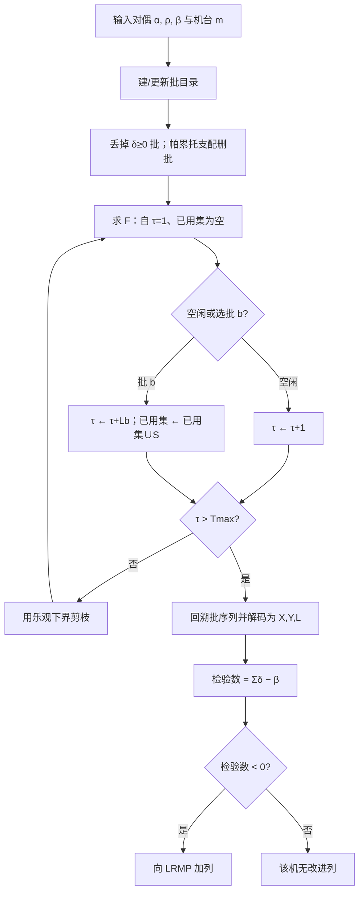
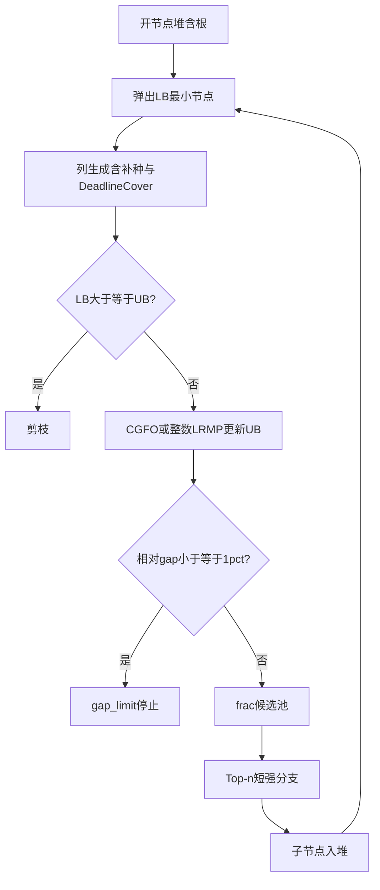

# 1方法说明与数值实验结果

> 章节结构按 `result_analyze_framework.md` 编排。
> 术语约定：**当前最好可行解** = 搜索中已找到的最小可行整数目标值，用作上界（UB）；**下界（LB）** 来自列生成 / 分支树对偶界；相对间隙 $\mathrm{gap}=(UB-LB)/UB$。
> **检验数**（列生成文献中的 reduced cost）：列相对当前对偶解的净改进量；检验数 $<0$ 表示该列可改进主问题。

本批方法设定：$U=5$，$M=5$；BPC 侧为 **BPC（frac_sb）**（精确 EBRP；割平面仅 **Deadline Cover**；`branch_strategy=frac_sb`：分数 Top-$K$ 候选池 + Top-$n$ 短强分支；上界仅 **CGFO + 整数 LRMP**）。
停机：时限 **或** 相对间隙 $\mathrm{gap}=(UB-\mathrm{tree\_LB})/UB\le 1\%$（BPC 的 $\mathrm{tree\_LB}$ 为开节点 LB 最小值；IM 用 Gurobi `MIPGap=0.01`）。
§5.4–5.5 为按 §5.1 规则生成的中/大规模正式结果；§5.3 小规模本批未重跑。

---

## 1. 问题背景

航空复合材料制造中，热压罐固化是典型的**配置依赖装箱过程**：同一罐在同一时刻只能按一种固化配置开工；匹配该配置的工件可合批装入，占罐时长由合批内加工时间决定；罐与罐之间通过物料去向与库存—缺货决策耦合。

Hao et al.（*European Journal of Operational Research*, 2022）提出将装箱与多级批量规模集成的整数规划（IM），并用 Dantzig–Wolfe 分解 + 列生成求紧下界，子问题用双层动态规划（BLDP：先背包最优批，再时序路由）精确求解。

本仓库问题在同一工业背景下，采用**单件 WIP、进罐时间窗与报废**等设定，建立集成模型 IM；求解上沿用“主问题 + 单机定价子问题”的分解，定价算法为 **EBRP**（Exact Batch Routing Pricing，对应 BLDP 的批—路由思想并适配单件唯一性）；整数化采用 **分支—定价—割平面（BPC）**，分支点由 **机器学习（LightGBM LambdaRank）** 排序选取。对比基线为 Gurobi 直接求解 IM。

---

## 2. 数学模型

### 2.1 符号

下文集合大写、参数小写、决策变量大写。成品入库按**单件** $lt_{it}$ 推算（$t'=t+lt_{it}-1$）；合批占罐跨期 $L=\max lt$ 仅用于机台不重叠。实现中无显式完工指示变量 $C$。

#### 2.2.1 集合与索引


| 符号                      | 含义                            |
| ------------------------- | ------------------------------- |
| $T$                       | 离散计划时段集合                |
| $I$                       | 单件物料集合（每件 1 单位 WIP） |
| $U$                       | 固化配置集合                    |
| $M$                       | 热压罐集合                      |
| $I_u=\{i\in I:u(i)=u\}$   | 配置$u$ 可加工的物料集          |
| $I_m=\{i\in I:b_{im}=1\}$ | 机台$m$ 可加工的物料集          |
| $M_i=\{m\in M:b_{im}=1\}$ | 物料$i$ 允许加工的机台集        |

#### 2.2.2 已知参数


| 符号               | 含义                                 |
| ------------------ | ------------------------------------ |
| $u(i)\in U$        | 物料$i$ 的固化配置                   |
| $rel_i,end_i$      | 物料$i$ 最早 / 最晚开工时段          |
| $d_{it}\in\{0,1\}$ | 物料$i$ 在时段 $t$ 的需求            |
| $lt_{it}$          | 物料$i$ 在 $t$ 开工时的占罐时段数    |
| $v_i$              | 工装（托盘）长度                     |
| $q_m$              | 热压罐$m$ 容量                       |
| $b_{im}\in\{0,1\}$ | 物料$i$ 是否可在机 $m$ 加工          |
| $hc_i,bc_i,rc_i$   | 持货、缺货、报废成本                 |
| $pc_{mu}$          | 机$m$ 上配置 $u$ 的 setup / 生产成本 |
| $w_i$              | WIP 量（本批算例均为 1）             |
| $\bar M$           | 足够大的常数（Big-M）                |

#### 2.2.3 决策变量


| 符号                | 类型                        | 含义                                     |
| ------------------- | --------------------------- | ---------------------------------------- |
| $X_{imt}$           | $\{0,1\}$                   | 物料$i$ 是否在机 $m$、期 $t$ 开工        |
| $Y_{umt}$           | $\{0,1\}$                   | 机$m$ 是否在期 $t$ 对配置 $u$ 新开 setup |
| $L_{umt}$           | $\mathbb{Z}_+$              | $(m,t)$ 上配置 $u$ 本次 setup 的占罐跨期 |
| $R_i$               | $\{0,1\}$                   | 物料$i$ 是否报废                         |
| $S_{it}^+,S_{it}^-$ | $\{0,1\}$                   | 库存 / 缺货                              |
| $Q_{mk}$            | $\ge 0$（松弛）或 $\{0,1\}$ | DW 主问题中机$m$ 上第 $k$ 列的权重       |

#### 2.2.4 集成模型（Integrated Model）

**目标函数**

$$
\min\ 
\sum_{i\in I}\sum_{t\in T}hc_i S_{it}^+
+\sum_{i\in I}\sum_{t\in T}bc_i S_{it}^-
+\sum_{m\in M}\sum_{u\in U}\sum_{t\in T}pc_{mu}Y_{umt}
+\sum_{i\in I}rc_i R_i.
$$

**约束**

**(IM-1) 成品流平衡**

$$
S_{i,t-1}^+-S_{i,t-1}^-
+\sum_{m\in M}\sum_{\substack{t'\in T\\ t'+lt_{i,t'}-1=t}}X_{imt'}
=d_{it}(1-R_i)+S_{it}^+-S_{it}^-
\quad\forall i\in I,\,t\in T.
$$

**(IM-2) 每机每期至多一种新开配置**

$$
\sum_{u\in U}Y_{umt}\le 1\quad\forall m\in M,\,t\in T.
$$

**(IM-3) 开始生产双向绑定**

$$
\sum_{i\in I_u}X_{imt}\le |I_u|Y_{umt},\qquad
Y_{umt}\le\sum_{i\in I_u}X_{imt}
\quad\forall u\in U,\,m\in M,\,t\in T.
$$

**(IM-4) 配置匹配**

$$
X_{imt}\le Y_{u(i),m,t}\quad\forall i\in I,\,m\in M,\,t\in T
\text{（仅在可行开工点建立）}.
$$

**(IM-5) 跨期下界与 setup 联动**

$$
L_{umt}\ge lt_{it}X_{imt}\quad\forall u,\,i\in I_u,\,m,\,t;
\qquad
L_{umt}\le\bar M\,Y_{umt}\quad\forall u,\,m,\,t.
$$

**(IM-6) 机台不重叠**（$t'>t$）

$$
L_{umt}-\bar M\,(2-Y_{umt}-Y_{u',m,t'})\le t'-t
\quad\forall m,\,u,u',\,t'>t.
$$

**(IM-7) 容量（开工时刻装箱）**

$$
\sum_{i\in I_m}v_i X_{imt}\le q_m\quad\forall m\in M,\,t\in T.
$$

**(IM-8) 单件去向**

$$
\sum_{m\in M_i}\sum_{t:rel_i\le t\le end_i}X_{imt}+R_i=1\quad\forall i\in I.
$$

**(IM-9) 时间窗 / 专属机台 / 期末**
不可行 $(i,m,t)$ 固定 $X_{imt}=0$。

#### 2.2.5 Dantzig–Wolfe 分解模型

按机台 $m\in M$ 分解：列 $k\in\mathcal{K}_m$ 为机 $m$ 上一个可行生产计划，参数为 $x^k,y^k,c_m^k,a_{i,t}^k,w_i^k$（开工、setup、setup 成本、完工入库、窗内开工量）。跨罐耦合仅通过库存流与物料去向留在主问题。

##### （1）主问题（限制主问题 LRMP）

**目标**

$$
\min\sum_{i,t}hc_i S_{it}^++\sum_{i,t}bc_i S_{it}^-+\sum_i rc_i R_i
+\sum_{m\in M}\sum_{k\in\mathcal{K}_m}c_m^k Q_{mk}.
$$

**约束**

**(LRMP-1) 成品流平衡**（对偶 $\alpha_{i,t}$）

$$
\sum_{m,k}a_{i,t}^k Q_{mk}+S_{i,t-1}^+-S_{i,t-1}^--S_{it}^++S_{it}^-
=d_{it}(1-R_i)
\quad\forall i\in I,\,t\in T.
$$

**(LRMP-2) 单件去向**（对偶 $\rho_i$）

$$
\sum_{m,k}w_i^k Q_{mk}+R_i=w_i\quad\forall i\in I.
$$

**(LRMP-3) 每机至多一列**（对偶 $\beta_m$）

$$
\sum_{k\in\mathcal{K}_m}Q_{mk}\le 1\quad\forall m\in M.
$$

**(LRMP-4) 变量域**：$Q_{mk}\ge 0$，$S_{it}^+,S_{it}^-,R_i\ge 0$（分支 / 切平面另加行，见第 4 节）。

列 $k$ 在机 $m$ 上的**检验数**：

$$
\bar c_m^k=c_m^k-\beta_m-\sum_i\rho_i w_i^k-\sum_{i,t}\alpha_{i,t}a_{i,t}^k.
$$

若 $\bar c_m^k<0$，则将该列加入主问题可改进当前 LRMP。

##### （2）子问题（单机定价）

固定机台 $m$。决策变量为 $X_{imt}$（$i\in I_m$）、$Y_{umt}$、$L_{umt}$；不含主问题的 $S_{it}^\pm$、$R_i$（报废与库存—缺货由主问题处理）。

**目标函数**（最小化该机列的检验数）

$$
\min\ 
\sum_{u\in U}\sum_{t\in T}pc_{mu}Y_{umt}
-\beta_m
-\sum_{i\in I_m}\rho_i\sum_{\substack{t\in T\\ rel_i\le t\le end_i}}X_{imt}
-\sum_{i\in I_m}\sum_{t\in T}\alpha_{i,\,t+lt_{it}-1}\,X_{imt}.
$$

**约束**

**(子-1) 每期至多一种新开配置**

$$
\sum_{u\in U}Y_{umt}\le 1\quad\forall t\in T.
$$

**(子-2) 开始生产双向绑定**

$$
\sum_{i\in I_u\cap I_m}X_{imt}\le |I_u\cap I_m|\,Y_{umt},
\qquad
Y_{umt}\le\sum_{i\in I_u\cap I_m}X_{imt}
\quad\forall u\in U,\,t\in T.
$$

**(子-3) 配置匹配**

$$
X_{imt}\le Y_{u(i),m,t}
\quad\forall i\in I_m,\,t\in T
\text{（仅在可行开工点建立）}.
$$

**(子-4) 跨期下界与 setup 联动**

$$
L_{umt}\ge lt_{it}X_{imt}
\quad\forall u\in U,\,i\in I_u\cap I_m,\,t\in T,
$$

$$
L_{umt}\le\bar M\,Y_{umt}
\quad\forall u\in U,\,t\in T.
$$

最优解中 $L_{umt}=\max\{lt_{it}:i\in I_u\cap I_m,\,X_{imt}=1\}$（无开工时为 0）。

**(子-5) 机台不重叠**（$t'>t$）

$$
L_{umt}-\bar M\,(2-Y_{umt}-Y_{u',m,t'})\le t'-t
\quad\forall u,u'\in U,\,t,t'\in T,\,t'>t.
$$

**(子-6) 容量（开工时刻装箱）**

$$
\sum_{i\in I_m}v_i X_{imt}\le q_m\quad\forall t\in T.
$$

**(子-7) 时间窗与计划期末可行**

$$
X_{imt}=0
\quad\text{若 }t<rel_i\text{ 或 }t>end_i\text{ 或 }t+lt_{it}-1>|T|.
$$

**(子-8) 可加工关系**

$$
X_{imt}=0\quad\forall i\notin I_m,\,t\in T
\quad\text{（本子问题变量本身只对 }i\in I_m\text{ 定义）}.
$$

**(子-9) 本机每件至多开工一次**

$$
\sum_{t\in T}X_{imt}\le 1\quad\forall i\in I_m.
$$

任一满足（子-1）–（子-9）的 $(X,Y,L)$ 对应一列 $k\in\mathcal{K}_m$。若子问题最优目标值（检验数）$<0$，将该列加入 LRMP。

---

## 3. 列生成算法

### 3.1 子问题结构分析

子问题需同时决定：**何时开何种配置的 setup**，以及**每个 setup 装哪些单件**。参照 Hao et al.：一旦某期 $Y_{ut}=1$，该期装箱在最优解中必为对应背包问题的最优解；多期 setup 序列则可视为时间轴上的路由。

本设定下进一步有：

- 有效物料集为 $I_m$，其规模决定定价难度；
- 合批跨期 $L_b=\max_{i\in S}lt_{i\tau}$，路由“弧长”可变；
- 约束（子-9）要求每件至多开工一次，故排程过程中必须记住**哪些物料已经用过**，不能只用“固定跨期 $l_u$ 的简单路径 DP”。

因此子问题等价于：在批目录上求一条物料不交、时段不重叠的批序列，使检验数最小。

### 3.2 子问题求解方法

本批实验仅用**精确 EBRP**（`ebrp_force=True`）。

#### 3.2.1 EBRP 基本逻辑

与论文 BLDP 同构的两层思想：

1. **批层**：生成可行批 $b=(u,\tau,S)$，批的边际贡献
   $$
   \delta_b=pc_{mu}-\sum_{i\in S}\bigl(\rho_i+\alpha_{i,\tau+lt_{i\tau}-1}\bigr)
   $$

   （分支 / 切平面对偶可再修正）。$\delta_b$ 是“开这一批相对对偶价格的净代价”。
2. **路由层**：在时间轴上串联互不重叠、物料不交的批，最小化 $\sum\delta_b$，再减去 $\beta_m$，得到该机列的检验数。

与论文 UKP（件数可为多）的差异：此处每件 0-1；第二层动态规划的状态除当前时刻外，还要用一个集合记录已用工件。

**帕累托支配（批目录剪枝）**
同一开工点上往往枚举出许多批。对固定机台、在同一比较单元内（实现中按配置—时段单元，展平后也按时段再剪一次），若批 $A=(u,\tau,S_A)$ 与批 $B=(u',\tau,S_B)$（同开工时刻）满足

$$
S_A\subseteq S_B,\qquad
L_A\le L_B,\qquad
\delta_A\le\delta_B,
$$

则称 **$A$ 帕累托支配 $B$**：$A$ 用的物料不多于 $B$、占罐不长于 $B$、边际代价不劣于 $B$。此时任意含 $B$ 的最优路由都可把 $B$ 换成 $A$（或更优），故可从目录中**删除 $B$ 而不损失最优检验数**。实现见 `_prune_batch_cell`：按 $(L,|S|,\delta)$ 排序后做上述检验。另：$\delta_b\ge 0$ 的批对最小化检验数无帮助，也直接丢弃。

**记号（后文命题共用）**
记 $T=\{1,\ldots,T_{\max}\}$。对已排物料集合 $U\subseteq I_m$，实现中常用长度为 $|I_m|$ 的 0-1 向量（**位图 / bitset**）编码：第 $i$ 位为 1 表示物料 $i$ 已排过。这只是集合 $U$ 的计算机表示，**不是**给物料重新编号；下文一律用集合符号 $U$，称为**已用物料集**。

批 $b=(u,\tau,S)$ 可行是指：满足容量与时间窗，$L_b=\max_{i\in S}lt_{i\tau}$，且可由（子-1）–（子-9）导出；目录中仅保留未被帕累托支配、且 $\delta_b<0$ 的批。列对应批序列 $\mathcal{B}=(b_1,\ldots,b_K)$，检验数为

$$
\bar c(\mathcal{B})=\sum_{k=1}^{K}\delta_{b_k}-\beta_m.
$$

#### 3.2.2 EBRP 最优性相关证明

**引理（帕累托删批安全）**
若 $A$ 帕累托支配 $B$（同上：$S_A\subseteq S_B$，$L_A\le L_B$，$\delta_A\le\delta_B$），则存在最优批序列不含 $B$。

*证明.* 若某可行序列使用了 $B$，将 $B$ 换成 $A$：物料集变小或不变，故与后续批仍可不交；占罐不变更长，故与前后批仍可不重叠；$\delta$ 不增，故总检验数不劣。反复替换后得到不含被支配批的最优序列。因此删去被支配批不改变最优值。□

**命题 1（批表示与子问题等价）**设 $(X,Y,L)$ 满足上文子问题的全部约束（子-1）–（子-9）。则存在唯一的批序列 $\mathcal{B}$，使得：

1. 每个 $Y_{u\tau}=1$ 对应恰好一批 $b=(u,\tau,S)$，其中 $S=\{i\in I_m:X_{i\tau}=1\}$，$L_b=L_{u\tau}$；
2. 各批占罐区间互不重叠，且不同批的 $S$ 两两不交；
3. $\bar c(\mathcal{B})$ 等于该 $(X,Y,L)$ 在子问题目标函数中的取值。

反之，任一满足不重叠与物料不交的可行批序列也可还原为满足（子-1）–（子-9）的 $(X,Y,L)$。

*证明.*
（⇒）由（子-1），每个时段至多一个配置的 $Y_{u\tau}=1$。对每个这样的 $(u,\tau)$，令 $S=\{i:X_{i\tau}=1\}$。由（子-2）（子-3），$S\subseteq I_u\cap I_m$ 且 $S\neq\varnothing$。由（子-4），$L_{u\tau}\ge\max_{i\in S}lt_{i\tau}$；在最优解中等式成立，记 $L_b=L_{u\tau}$。由（子-6）（子-7）得批可行。由（子-5），若另有 $Y_{u'\tau'}=1$ 且 $\tau'>\tau$，则 $\tau'\ge\tau+L_{u\tau}$，即批不重叠。由（子-9），同一 $i$ 不可能出现在两个开工时段，故批间 $S$ 不交。将所有 setup 按开工时刻排序即得 $\mathcal{B}$。

目标函数中 $\sum pc_{mu}Y_{umt}$ 按批相加即为 $\sum_b pc$；$\rho,\alpha$ 项按单件开工与完工时刻计入，与 $\sum_b\sum_{i\in S}(\rho_i+\alpha_{i,\tau+lt_{i\tau}-1})$ 一致，故目标值 $=\sum_b\delta_b-\beta_m=\bar c(\mathcal{B})$。

（⇐）对批序列中每一批置 $Y_{u\tau}=1$、$X_{i\tau}=1$（$i\in S$）、$L_{u\tau}=L_b$，其余为 0，直接验证（子-1）–（子-9）。□

**命题 2（动态规划递推给出最优检验数）**

定义值函数 $F(\tau,U)$（$\tau\in\{1,\ldots,T_{\max}+1\}$，$U\subseteq I_m$）为：
在**当前最早可开工时刻为 $\tau$**、**集合 $U$ 中的物料已经排过（不可再用）** 的前提下，从该状态排到计划期末所能达到的**最小批边际成本和** $\sum\delta$（尚未减 $\beta_m$）。边界条件：

$$
F(T_{\max}+1,U)=0\quad\forall U\subseteq I_m.
$$

对 $\tau\le T_{\max}$，决策只有两类——（i）时段 $\tau$ 空闲，转到 $(\tau+1,U)$；（ii）在 $\tau$ 选一可行批 $b=(u,\tau,S)$，要求 $S\cap U=\varnothing$，转到 $(\tau+L_b,\,U\cup S)$ 并支付 $\delta_b$。故

$$
F(\tau,U)
=\min\Biggl\{
F(\tau+1,U),\ 
\min_{\substack{b=(u,\tau,S)\\ S\cap U=\varnothing}}
\bigl[\delta_b+F(\tau+L_b,\,U\cup S)\bigr]
\Biggr\}.
$$

（若无可行批，第二项视为 $+\infty$。）

则子问题最优检验数等于 $F(1,\varnothing)-\beta_m$。也就是说：从“时刻 1、尚未用任何物料”出发，按上述最优递推得到的值，再减 $\beta_m$，就是子问题的最优目标。

说明：动态规划里“当前状态的最优值 = 对所有合法一步决策取最优，再加后继状态最优值”这一原理，常称为 **Bellman 最优性原理**；上式正是该原理在本问题上的具体写法，并非另引入一个新对象。

*证明.*
对 $\tau$ 从 $T_{\max}+1$ 递减到 $1$ 做归纳。

当 $\tau=T_{\max}+1$ 时已无时段可排，成本和为 0，与边界一致。

设对所有 $\tau'>\tau$、一切 $U$，断言“$F(\tau',U)$ 等于该状态下的最小剩余成本和”已成立。在状态 $(\tau,U)$：任一可行续排方案的第一步要么空闲，要么选某批 $b$。若空闲，剩余最优成本和为 $F(\tau+1,U)$（归纳假设）。若选 $b$，则立即支付 $\delta_b$，且后继状态为 $(\tau+L_b,U\cup S)$，其最优剩余为 $F(\tau+L_b,U\cup S)$（归纳假设）；因 $L_b\ge 1$，有 $\tau+L_b>\tau$。对所有合法第一步取最小，恰得递推式右端，故 $F(\tau,U)$ 为该状态最优值。

特别地，$F(1,\varnothing)$ 是“从计划期初、未用任何物料”的最小 $\sum\delta$。由命题 1，这等价于在全部可行 $(X,Y,L)$ 上最小化子问题目标中除 $-\beta_m$ 外的部分，因而最优检验数为 $F(1,\varnothing)-\beta_m$。□

**命题 3（乐观下界剪枝不损失最优性）**

命题 2 中的 $F(\tau,U)$ 即“从状态 $(\tau,U)$ 起的最小剩余批成本和”。实现中另算一个**更松的下界** $\underline{\ell}(\tau)$：忽略“物料不可重复”等耦合，只按时刻累加“该时刻最负的批 $\delta$（若全非负则取 0）”。于是对任意已用集 $U$，

$$
\underline{\ell}(\tau)\ \le\ F(\tau,U).
$$

因此，若搜索中已支付的部分成本和为 $\pi$，且 $\pi+\underline{\ell}(\tau)-\beta_m$ 已不低于当前最好检验数（或已 $\ge 0$ 因而得不到负检验数列），则可剪掉该分支而**不会删掉真正的最优解**。

*证明.* $\underline{\ell}$ 对应的可行域不小于原问题（允许“重复用物料”等），最小值只可能更小（更负或相等），故 $\underline{\ell}(\tau)\le F(\tau,U)$。若 $\pi+\underline{\ell}(\tau)$ 已不能改进，则更紧的 $\pi+F(\tau,U)$ 也不能改进。□

#### 3.2.3 EBRP 算法流程图



列生成外环：解 LRMP → 各机并行 EBRP → 加入检验数 $<0$ 的列 → 直至无负检验数列；有效下界 $\mathrm{LB}=\mathrm{LRMP}+\sum_m\min\{\eta_m^*,0\}$，其中 $\eta_m^*$ 为机 $m$ 子问题最优检验数。

## 4. 分支定价割框架

### 4.1 割平面类型

当前实现**仅启用 Deadline Cover**（`tight_deadline=True` 收紧右端）。WIP Process LB、Setup Pair、同机同期 setup 割、以及窄间隙 Gomory 报废取整均已关闭（`merge_cut_options` 强制关掉；`reinforce_with_cuts` 为空操作）。

#### 截止期覆盖不等式（Deadline Cover）

**含义**：对每个出现过的截止时刻 $\tau$，凡是必须在 $\tau$ 及以前完工入库的物料集合 $I(\tau)$，它们在 $\tau$ 之前的**总完工件数**不能超过系统在 $[1,\tau]$ 内物理上能装下并完工的件数上界。该上界就是不等式的右端 **RHS（Right-Hand Side）**。

记

$$
I(\tau)=\{i\in I:end_i\le\tau\}.
$$

对机 $m$ 上第 $k$ 列，令 $a_k(\tau)$ 为该列使 $I(\tau)$ 中物料**完工时刻 $\le\tau$** 的件数之和（实现中按列的开工与提前期推算到达期）。主问题加约束：

$$
\sum_{m\in M}\sum_{k\in\mathcal{K}_m}a_k(\tau)\,Q_{mk}\ \le\ \mathrm{RHS}(\tau).
$$

- **左端**：分数解下，“$\tau$ 前完工的 $I(\tau)$ 件数”的凸组合。
- **右端 $\mathrm{RHS}(\tau)$**：不依赖列池，只由容量、托盘长度与最短占罐时长估算的**可行完工件数上界**。

#### RHS 怎么算（tight deadline）

实现见 `deadline_cover_rhs`（`lrmp_cuts.py`）。对固定 $\tau$ 与 $I(\tau)$：

1. 取 $I(\tau)$ 中最大托盘长 $v^{\max}=\max_{i\in I(\tau)}v_i$（最“占地方”的件，用来估单次 setup 最多几件）；
2. 取全体配置最短占罐时长 $\ell^{\min}=\min_u \ell_u$（最短一次 setup 占用几个时段）；
3. 到时刻 $\tau$ 前，单机最多不相交 setup 次数
   $$
   S(\tau)=\max\bigl(1,\ \lfloor\tau/\ell^{\min}\rfloor\bigr);
   $$
4. 机 $m$ 每次 setup 最多托盘数（件数）$\mathrm{trays}_m=\lfloor q_m/v^{\max}\rfloor$；
5. 汇总各机：
   $$
   \mathrm{RHS}(\tau)=\sum_{m\in M}S(\tau)\cdot\mathrm{trays}_m.
   $$

直观理解：每台机最多开 $S(\tau)$ 次罐，每次最多装 $\mathrm{trays}_m$ 件，乘起来再对机台求和，就是 $\tau$ 前最多能“覆盖”多少件必须在 $\tau$ 前完工的物料。用 $v^{\max}$ 而不是 $\min v_i$，会得到**更小（更紧）**的 RHS，因此叫 tight deadline。

主问题对每个不同的 $end_i$ 值各建一条上述割；列加入主问题时，把对应的 $a_k(\tau)$ 写进左端系数。

#### 数值例子

设 $|M|=2$，$q_1=q_2=10$，$\ell^{\min}=4$，截止 $\tau=12$。
$I(12)$ 中 6 件物料的托盘长分别为 $3,3,4,4,5,5$，故 $v^{\max}=5$。

则

$$
S(12)=\lfloor 12/4\rfloor=3,\qquad
\mathrm{trays}_m=\lfloor 10/5\rfloor=2\quad(m=1,2),
$$

$$
\mathrm{RHS}(12)=3\cdot 2+3\cdot 2=12.
$$

即：两台机到时段 12 前合计最多完工 **12** 件“截止 $\le 12$”的物料。

若某分数解中，两台机各选了列，使 $I(12)$ 在 $\tau=12$ 前完工件数的凸组合为

$$
0.6\cdot 8+0.4\cdot 7\;+\;0.5\cdot 6+0.5\cdot 5=4.8+5.5=10.3\le 12
$$

（可行）；若左端算得 $12.5$，则违反 Deadline Cover，割平面起作用，逼迫解减少过早/过多对 $I(12)$ 的完工分配，或换列。

对比：若不用 tight、改用全体最小托盘 $v^{\min}=3$，则 $\mathrm{trays}_m=\lfloor 10/3\rfloor=3$，$\mathrm{RHS}=3\cdot 3\cdot 2=18$，上界更松，割更弱。本批实验开启 tight，因此用 $v^{\max}$ 这一套。

### 4.2 分支类型

由 LRMP 解诱导分数量。记

$$
\hat Y_{umt}=\sum_k y_{umt}^k Q_{mk},\quad
W_i=\sum_{m,k}w_i^k Q_{mk},\quad
\hat R_i=R_i\text{（主问题变量）}.
$$

三类分支共用同一候选池，由 §4.3 的 **frac Top-$K$ + Top-$n$ 短强分支**选出一个再展开左右子节点。

#### （1）Setup 分支（问题特异性最强）

若 $\hat Y_{umt}\notin\{0,1\}$，生成：

- 一侧：$Y_{umt}=0$（定价删该 setup；列池去掉含该 setup 的列）；
- 另一侧：$Y_{umt}=1$（常延后处理）。

**例**：$\hat Y_{2,0,5}=0.47$，分支为强制不开 / 强制开该 setup。

#### （2）WIP 分支（时间窗过程量）

若 $W_i\notin\mathbb{Z}$，令 $\ell=\lfloor W_i\rfloor$，$c=\lceil W_i\rceil$，生成 $W_i\le\ell$ 与 $W_i\ge c$。

**例**：$W_i=0.6\Rightarrow W_i\le 0$ 或 $W_i\ge 1$（本批 $w_i=1$ 时即“本窗不加工” vs “必须加工”）。

#### （3）报废分支

若 $\hat R_i\notin\{0,1\}$，生成 $R_i=1$ 与延后的 $R_i=0$。

- $R_i=1$：主问题加 $R_i\ge 1$；
- $R_i=0$：主问题加 $R_i\le 0$（结合 WIP 平衡 $R_i+W_i=w_i$，即强制窗内加工量 $W_i=w_i$）。

**例**：$R_i=0.35\Rightarrow$ 强制报废 / 强制不报废。

#### 强制侧列池与补种

对强制侧（$Y=1$、$W\ge$、$R=0$），子节点**继承**父节点列池（按 $Y$ 过滤），并在进入正式 CG 前做**覆盖性补种**：对需覆盖加工的物料抬高 WIP 对偶 $\rho$，用定价生成含这些物料的列，使 LRMP 先可行再迭代。$Y=1$ 侧另用规范定价补全 forced setup 列。若首轮主问题仍不可行，再补种一次（至多一次）。

### 4.3 基于分数 Top-$n$ 的短强分支

本批正式方法为 `branch_strategy=frac_sb`（**不使用** LightGBM / `ml_branch_model.txt`）。代码中仍保留 `ml` 路径，但不作为本章实验配置。

#### 4.3.1 候选池（frac Top-$K$）

1. 枚举当前节点所有分数的 setup / WIP / scrap；
2. 对每个候选计算 $\mathrm{frac}=\min(f,1-f)$（越接近 $0.5$ 越大）；
3. 跨类型按 $\mathrm{frac}$ 降序排序，保留 **Top-$K$**（实现默认 $K=20$，`TOP_K_DEFAULT`）。

三类变量混在同一池中比较，不各自单独粗排。

#### 4.3.2 短强分支精选（Top-$n$）

对池内 **Top-$n$**（默认 $n=\texttt{FRAC\_SB\_REFINE\_K}=5$）每个候选：

1. 构造左右两侧分支（列池 warm start）；
2. 各跑一次短时 CG，得子节点下界提升 $\Delta_L,\Delta_R$（相对父 LB）；
3. 评分 $y_{\min}=\min(\Delta_L,\Delta_R)$，取 $y_{\min}$ 最大者开枝。

若剩余墙钟不足（与实现中短 SB 最小剩余阈值一致），则跳过精选，直接取 frac 排序第一的候选。

#### 4.3.3 小例（示意）

示意 Top-3 入精选池（实际默认对 Top-5 做短 SB）：


| 候选                   | frac | 类型  | $\Delta_L$ | $\Delta_R$ | $y_{\min}$ |
| ---------------------- | ---- | ----- | ---------- | ---------- | ---------- |
| $Y_{u_1 m_2 t_8}=0.48$ | 0.48 | setup | 12.0       | 40.0       | 12.0       |
| $W_5=0.55$             | 0.45 | WIP   | 35.0       | 28.0       | **28.0**   |
| $R_9=0.30$             | 0.30 | scrap | 5.0        | 80.0       | 5.0        |

→ 选 $W_5$ 做 WIP 分支（$y_{\min}$ 最大）。

### 4.4 上界方法

维护标量 **当前最好可行解 UB**；仅以下两种途径更新（取更优者）：


| 方法          | 时机                                 | 做法                                                                                   |
| ------------- | ------------------------------------ | -------------------------------------------------------------------------------------- |
| **CGFO**      | 根节点一次；非根节点在剩余时间充足时 | 由分数列支撑构造允许的$Y$，其余压 0，再解受限 IM（Hao et al. CGFO 思想）               |
| **整数 LRMP** | 任一节点                             | 若诱导$\hat Y$、$Q$、$R$ **全部已整数**，则 LRMP 目标值本身就是可行整数解，直接作为 UB |

已去掉：根/节点 RMP-IP、根完整 IM、贪心取整 IM、节点附近 IM、终局 IM。搜索结束时**保留过程中最好的 UB**，不再额外抛光。

说明：`root_im` / `final_im` / `use_node_im` 参数仍保留在接口中，但上界路径不再使用它们。

### 4.5 分支定价割总体流程

**概述**：每个节点列生成得 LB（强制侧可补种）；用 CGFO / 整数 LRMP 更新 UB；分数则按 frac Top-$K$ + Top-$n$ 短 SB 选 setup/WIP/报废分支；节点 CG 始终带 Deadline Cover；$\mathrm{LB}\ge\mathrm{UB}$ 剪枝；全局 $\mathrm{tree\_LB}=\min\{\text{开节点 LB}\}$，若 $(\mathrm{UB}-\mathrm{tree\_LB})/\mathrm{UB}\le\texttt{mip\_gap}$（默认 $1\%$）则停（状态 `gap_limit`）。证优仍要求开节点耗尽且全程无 CG 失败。



```
开节点堆 ← {根}；UB ← +∞
while 有开节点 且 未超时 且 未证优 且 未达 gap_limit:
    弹出 LB 最小节点 N
    列生成（继承列池；强制侧补种；Deadline Cover）→ LB(N)
    若 LB(N) ≥ UB → 剪枝
    用 CGFO / 整数 LRMP 更新 UB
    tree_LB ← min{开节点 LB 估计}
    若 UB 有限且 (UB − tree_LB)/UB ≤ mip_gap → 停止（gap_limit）
    若诱导 Y/Q/R 已整数 → 用 LRMP 目标更新 UB；不分支
    否则：frac Top-K → Top-n 短 SB 选分支 → 子节点入堆（列池 warm start）
输出过程中最好的 UB、tree_LB、状态
```

---

## 5. 数值实验

实验对比：**IM**（Gurobi）与 **BPC（frac_sb）**（上文章节配置）。

### 5.1 算例生成规则

统一 $U=5$，$M=5$，由 `SetConfig('small_cg', T, U, 0, I, M)` 与给定 seed 生成。三档 **只改 $T$、$I$、seed 与求解时限**；LT 与时间窗规则完全相同。

**共用参数**


| 参数                            | 取值               | 说明                                                                                          |
| ------------------------------- | ------------------ | --------------------------------------------------------------------------------------------- |
| LT（`BENCH_LEAD_TIME_CHOICES`） | $\{5,6,7,8,9,10\}$ | 各配置均匀抽取占罐基础时长                                                                    |
| 窗长`length_range`              | $[12,16]$          | **绝对时段**，小/中/大相同（不随 $T$ 变）；相对 LT 约有 $+7$ 松弛，避免窗$\approx$LT 导致过易 |
| 就绪`rel_frac`                  | $[0.10,\,0.50]$    | $rel_i$ 落在 $[0.1T,\,0.5T]$（再截断使窗不越界）                                              |

**分档规模**（难度靠 $T$、$I$ 拉开，不靠拉长窗）


| 档 | 实例 / 标识      | $T$ | $I$ | seed   | 求解时限  |
| -- | ---------------- | --- | --- | ------ | --------- |
| 小 | 本批未列入对比   | 30  | 40  | —     | 900s      |
| 中 | `30101`–`30501` | 35  | 50  | 见左列 | **1800s** |
| 大 | `40101`–`40501` | 40  | 55  | 见左列 | **3600s** |

> 规模调整：原中(30,40)→现小；原大(35,50)→现中（IM 时限 1800s）；现大=(40,55)（IM 时限 3600s）。

实现：`configuration.BENCH_*`、`BENCH_SMALL/MEDIUM/LARGE`、`apply_bench_generation()`；生成器对 `small_cg` 使用 `length_range` 与 `BENCH_LEAD_TIME_CHOICES`。

### 5.2 分支策略与求解设定

本批**不**训练 / 部署 ML 分支模型。BPC 与 IM 的关键超参如下。


| 项       | 取值                                                                                                        |
| -------- | ----------------------------------------------------------------------------------------------------------- |
| BPC 策略 | `frac_sb`；$K=20$（候选池）；$n=\texttt{FRAC\_SB\_REFINE\_K}=5$（短 SB）                                    |
| 定价     | 精确 EBRP，`ebrp_force=True`                                                                                |
| 割       | 仅 Deadline Cover（含 tight RHS）                                                                           |
| 上界     | CGFO + 整数 LRMP                                                                                            |
| BPC 停机 | 时限，或$(\mathrm{UB}-\mathrm{tree\_LB})/\mathrm{UB}\le 1\%$（`DEFAULT_BP_MIP_GAP=0.01`）                   |
| IM 停机  | 时限，或 Gurobi`MIPGap=0.01`                                                                                |
| 数据来源 | `bpc_frac_gap1pct_5med_5large.json`，`im_gap1pct_5med_5large.json`；汇总见 `im_bpc_medium_large_compare.md` |

节点选点流程（与 §4.3 一致）：

```text
父节点 CG → 枚举分数候选 → frac Top-20 → Top-5 短强分支 → 开枝
```

### 5.3 小规模算例结果分析

时限 900s，规模 $(T,I)=(30,40)$。
**本批未按 §5.1 新窗 + frac_sb 正式重跑小规模**，故此处不附数值表。待补跑后再与 IM 对比 UB / LB / gap / 时间。

### 5.4 中规模算例结果分析

时限 1800s，$(T,I)=(35,50)$，种子 `30101`–`30501`。


| seed     |   IM UB |   IM LB |  IM gap% | IM 时间(s) |  BPC UB |  BPC LB | BPC gap% | BPC 时间(s) | BPC 状态  |
| -------- | ------: | ------: | -------: | ---------: | ------: | ------: | -------: | ----------: | --------- |
| 30101    | 40226.3 | 34763.9 |    13.58 |     1801.3 | 40226.3 | 39915.4 |     0.77 |        26.7 | gap_limit |
| 30201    | 32784.3 | 30409.6 |     7.24 |     1801.3 | 32784.3 | 32486.4 |     0.91 |        26.9 | gap_limit |
| 30301    | 34145.3 | 32321.6 |     5.34 |     1801.8 | 34325.5 | 34035.7 |     0.84 |        47.0 | gap_limit |
| 30401    | 25920.6 | 23982.9 |     7.48 |     1801.4 | 25559.0 | 25307.5 |     0.98 |      1153.5 | gap_limit |
| 30501    | 33217.8 | 30745.8 |     7.44 |     1801.6 | 33217.8 | 32886.1 |     1.00 |       429.1 | gap_limit |
| **均值** |      — |      — | **8.22** | **1801.5** |      — |      — | **0.90** |   **336.6** | 5/5 达 1% |

**分析**：IM 5/5 均满时限且未触达 1% gap（平均约 8.2%）。BPC 5/5 以 `gap_limit` 停在约 1% 内，平均 gap≈0.90%，平均时间约 337s（约 **5.3×** 快于 IM）。两侧 UB 接近；BPC 优势主要来自更紧的 tree LB。全程 `nodes_cg_failed=0`。

来源：`im_gap1pct_5med_5large.json`；`bpc_frac_gap1pct_5med_5large.json`。

### 5.5 大规模算例结果分析

时限 3600s，$(T,I)=(40,55)$，种子 `40101`–`40501`。


| seed     |   IM UB |   IM LB |   IM gap% | IM 时间(s) |  BPC UB |  BPC LB | BPC gap% | BPC 时间(s) | BPC 状态   |
| -------- | ------: | ------: | --------: | ---------: | ------: | ------: | -------: | ----------: | ---------- |
| 40101    | 26058.5 | 22272.4 |     14.53 |     3602.4 | 25902.8 | 25562.9 |     1.31 |      3600.5 | time_limit |
| 40201    | 38244.4 | 34094.0 |     10.85 |     3602.6 | 38310.9 | 37932.7 |     0.99 |      1839.0 | gap_limit  |
| 40301    | 27897.5 | 23594.2 |     15.43 |     3601.9 | 27464.5 | 26899.2 |     2.06 |      3602.6 | time_limit |
| 40401    | 23639.6 | 21683.0 |      8.28 |     3601.8 | 23594.6 | 23221.6 |     1.58 |      3602.5 | time_limit |
| 40501    | 34643.6 | 32100.7 |      7.34 |     3602.4 | 34759.1 | 34415.3 |     0.99 |       604.0 | gap_limit  |
| **均值** |      — |      — | **11.28** | **3602.2** |      — |      — | **1.39** |  **2649.7** | 2/5 达 1%  |

**分析**：IM 5/5 满时限，平均 gap≈11.3%。BPC 平均 gap≈1.39%（约 **8×** 更紧）：其中 40201、40501 达 1% 且明显更快；40101 / 40301 / 40401 跑满 1h 仍略高于 1%（约 1.3%–2.1%）。UB 互有胜负；差距主因仍是 BPC 下界更紧。全程 `nodes_cg_failed=0`。

来源：同上。

### 5.6 初步结论和待改进点

**当前方法设定（与代码 / 本批实验一致）**

1. **割**：仅 Deadline Cover（含 tight RHS）。
2. **分支**：setup / WIP / scrap；**frac Top-$K$ + Top-$n$ 短强分支**（`frac_sb`，$n=5$）。
3. **强制侧**：列池继承 + 覆盖性补种；`R=0` 施加 $R_i\le 0$。
4. **上界**：仅 CGFO + 整数 LRMP；结束保留最好 UB。
5. **停机**：时限或相对 gap $\le 1\%$（BPC 用全局开节点最小 LB）。
6. **算例**：三档共用 LT$\in\{5..10\}$、窗长 $[12,16]$；本批对比中 $(35,50)$、大 $(40,55)$。

**本批结果倾向（§5.4–5.5）**

1. **中规模**：BPC 在 gap 与时间上相对 IM 全面优势（5/5 达 1%；平均时间约 337s vs 1801s）。
2. **大规模**：BPC gap 仍显著更紧（平均约 1.4% vs 11.3%）；2/5 达 1%，其余满时限但 gap 已远小于 IM。
3. 优势主要来自 **LB**；UB 质量两边接近。

**待改进**

1. 补跑小规模 $(30,40)$@900s 的 IM vs BPC（frac_sb，gap≤1%）。
2. 大规模未达 1% 的实例：加强早期 CGFO / 证优策略（割面、prove-mode）。
3. 若恢复 ML 分支，需在窗 `[12,16]` 与当前强制侧逻辑下重采重训，不能直接用旧模型。
